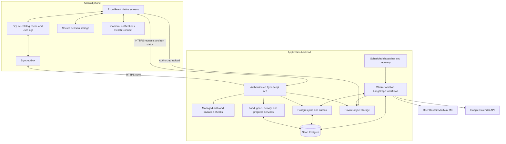
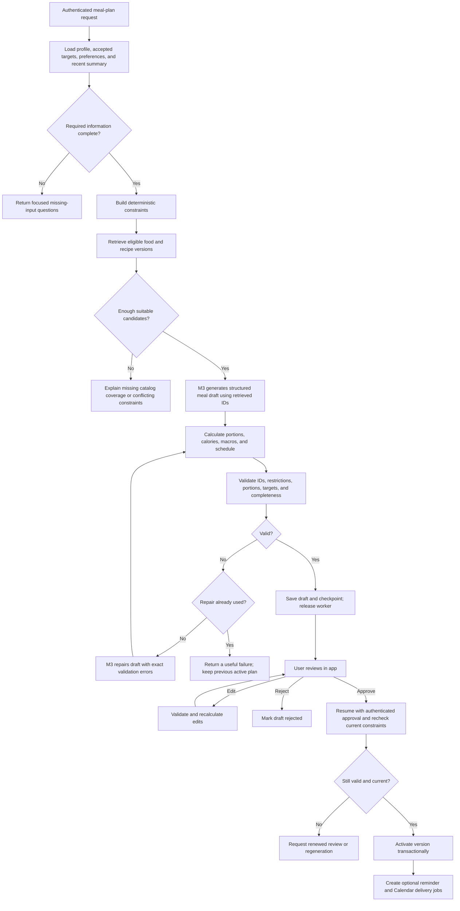
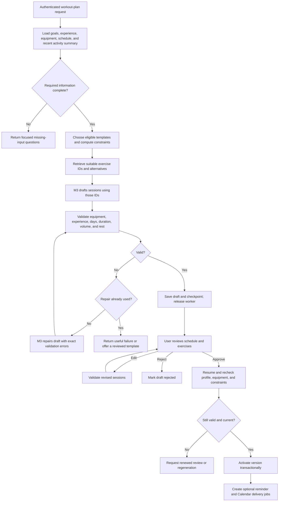
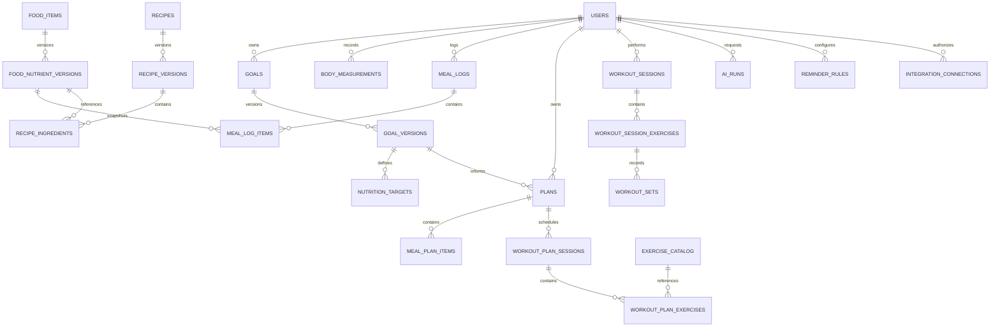

# Android Health App — Product, Architecture, and Implementation Plan

**Working name:** Goal Health; final name and package ID to be chosen before distribution.

**Document date:** 20 October 2026.

**Audience:** The owner and developers implementing the app.

**Distribution:** A signed Android APK for the owner and invited friends.

**Status:** Implementation specification. The app, cloud resources, integrations, and APK have not been created by this document.

This plan consolidates the agreed features and design direction. Details that were not explicitly chosen in the conversation are proposed defaults. Provider availability, package compatibility, quotas, and Android behavior must be confirmed in Phase 0 and again before release.

## Contents

1. [Product goal and decisions](#1-product-goal-and-decisions)
2. [Features and release scope](#2-features-and-release-scope)
3. [Design system and screen structure](#3-design-system-and-screen-structure)
4. [Onboarding, goals, and target calculations](#4-onboarding-goals-and-target-calculations)
5. [Food database and tracking](#5-food-database-and-tracking)
6. [Workout and activity tracking](#6-workout-and-activity-tracking)
7. [Progress graph and forecasting](#7-progress-graph-and-forecasting)
8. [Technology stack and architecture](#8-technology-stack-and-architecture)
9. [AI calls and model configuration](#9-ai-calls-and-model-configuration)
10. [Two LangGraph workflows and memory](#10-two-langgraph-workflows-and-memory)
11. [Database design](#11-database-design)
12. [API and offline synchronization](#12-api-and-offline-synchronization)
13. [Android and Health Connect](#13-android-and-health-connect)
14. [Reminders and Google Calendar](#14-reminders-and-google-calendar)
15. [Privacy, reliability, and cost controls](#15-privacy-reliability-and-cost-controls)
16. [Implementation phases](#16-implementation-phases)
17. [Deployment and APK runbook](#17-deployment-and-apk-runbook)
18. [Using the app](#18-using-the-app)
19. [Release acceptance and future work](#19-release-acceptance-and-future-work)
20. [Reference documentation](#20-reference-documentation)

## 1. Product goal and decisions

Build an Android app that helps a person understand how daily food, exercise, and actual body measurements relate to a chosen goal and timeline. The central experience is a progress graph showing the original plan beside measured progress. Food and workout logging provide the inputs for that experience.

The app should work comfortably for Indian meals, household portions, mixed dishes, packaged snacks, restaurant food, and the foods the invited group actually eats. A curated catalog should grow from real usage rather than attempting to import every possible food before launch.

### 1.1 Decisions already agreed

| Area | Decision |
| --- | --- |
| Main platform | Android phones |
| Audience | Owner and invited friends, with separate private accounts |
| Distribution | Direct installation of an APK; no planned Play Store release |
| Cloud database | Neon Postgres |
| AI model | MiniMax M3; the selected `minimax/minimax-m3` identifier is an OpenRouter route |
| AI orchestration | Two bounded LangGraph workflows: meal planning and workout planning |
| Food photos | A separate recognition operation that suggests food matches |
| Food quantities | User enters or confirms the amount; the image does not establish an exact portion |
| Nutrition values | Derived from stored food or recipe data and confirmed quantities |
| Core differentiator | Interactive actual-versus-plan progress graph |
| Visual style | Minimal black, white, gray, and lime/green, based on the supplied references |

### 1.2 Proposed implementation defaults

- React Native with Expo and TypeScript for the Android app.
- A modular backend in TypeScript, initially deployed with Neon Functions.
- Managed Neon Auth for identity, subject to the mobile integration check in Phase 0.
- Private object storage for food photos; Neon Object Storage is the initial choice.
- SQLite on the phone for offline logs, cached catalog entries, and a synchronization outbox.
- Health Connect for available phone and connected-app activity data.
- Local notifications for everyday reminders; optional Google Calendar synchronization.
- Adults using general fitness and nutrition tracking are the initial supported audience.

The audience being small does not make the database local to the phone. The installed app runs on the phone, local records can work offline, and cloud synchronization requires an internet connection and a deployed backend.

## 2. Features and release scope

### 2.1 First complete private release

| Feature group | Included behavior |
| --- | --- |
| Accounts | Invite-based signup, login, logout, session renewal, account recovery |
| Profile | Measurements, goal, food preferences, allergies, activity habits, equipment, schedule, units, timezone |
| Food catalog | Search, aliases, common portions, source information, favorites, recent foods, custom foods and recipes |
| Food logging | Manual food/quantity entry, photo-assisted identification, multiple foods per meal, editing and deletion |
| Nutrition | Calories, protein, carbohydrate, fat; fiber and other nutrients when available |
| Meal plans | A structured weekly plan with catalog references, portions, totals, substitutions, review, and approval |
| Workout plans | A weekly schedule based on goals, experience, equipment, available days, and session time |
| Activity logs | Sets, reps, weights, walking/cardio duration, optional steps, completion notes |
| Progress | Actual measurements, trend, original plan, goal/date marker, history, contextual annotations |
| Daily dashboard | Food totals, workout status, steps when available, reminder status, and logging completeness |
| Android integration | Photo picker/camera, secure session storage, Health Connect when supported, notification permissions |
| Reminders | Meal logging, workout, weigh-in, optional hydration, weekly review |
| Calendar | Opt-in synchronization of approved schedule items to an app-created Google calendar |
| Offline | Create/edit normal logs offline; synchronize when connectivity returns |
| Privacy | Each person sees their own records; export and deletion controls |
| Distribution | Signed standalone APK, installation instructions, documented update process |

Hydration is an optional simple log and reminder, not a requirement for calorie tracking. Heart rate is not a launch requirement because the app cannot assume the phone or a wearable supplies it. Friends do not automatically see one another's health data.

### 2.2 Milestones

1. **Manual tracking MVP:** Accounts, onboarding, food catalog, manual food/workout logging, offline sync, and the main progress graph.
2. **AI milestone:** Food recognition and both reviewed planning workflows.
3. **Connected private release:** Health Connect, reminders, Calendar, release hardening, and a signed APK for friends.

Ship an internal APK at the manual MVP milestone so the graph and logging experience can be used before all integrations are finished.

## 3. Design system and screen structure

### 3.1 Visual direction

Use the supplied images as visual references for spacing, rounded cards, food photography, typography hierarchy, and the green accent. Create original screen layouts for this app's functions. Android status bars, system navigation, and permissions should follow Android behavior.

Proposed design tokens:

| Token | Proposed value | Purpose |
| --- | --- | --- |
| App background | `#F6F7F4` | Soft off-white page background |
| Card surface | `#FFFFFF` | Primary content containers |
| Primary text | `#121512` | Headings, values, main copy |
| Secondary text | `#626A60` | Captions and supporting details |
| Soft divider | `#E7EBE3` | Borders and separators |
| Lime accent | `#B8EA55` | Buttons and selected states, with dark text |
| Light green surface | `#E3F4BE` | Selected cards and gentle highlights |
| Dark green | `#2E6B33` | Actual progress line and readable green labels |
| Warning/error | Accessible amber/red | Exceptions and validation; always include text |
| Typeface | Inter | Proposed sans-serif; the reference font has not been positively identified |

Use tabular numerals for changing measurements, an 8-point spacing rhythm, generous margins, card radii around 20–24 dp, and pill-shaped controls. Primary touch targets should be at least 48 dp. Check final color contrast, font scaling, and TalkBack behavior. Lime is an accent; small lime text on white will usually need a darker alternative.

Food photography belongs on welcome, meal, and recipe views. The progress graph should have a calm background and enough space to read its axes. Avoid decorative chart lines that could be confused with data.

### 3.2 Navigation

Use four labeled bottom tabs: **Home, Food, Activity, Progress**. A visible add button opens quick actions: log food, take/select food photo, log workout, add weight. Profile and settings open from the Home avatar.

| Screen | Main content and actions |
| --- | --- |
| Welcome | Short product explanation, goal graph preview, signup/login |
| Onboarding | A few focused steps with a progress indicator and editable review |
| Home | Greeting, goal summary, compact hero graph, today's food totals, activity, next reminder |
| Food | Day selector, meals, calories/macros, manual search and photo actions |
| Food search | Search, favorites, recents, portion selector, source/preparation labels |
| Photo review | Recognized candidates, uncertain items, manual search fallback, quantity confirmation |
| Meal plan | Week overview, meal details, swaps, nutritional totals, approve/edit controls |
| Activity | Today's workout, walking/cardio entries, steps and source, manual log controls |
| Workout session | Exercises, sets/reps/load, rest timer, completion notes |
| Workout plan | Weekly split, equipment requirements, session duration, review and approval |
| Progress | Large interactive graph, metric selector, time range, annotations, weekly review |
| Settings | Units, profile, goals, connections, reminders, privacy, data export, app version |

Every important view needs empty, loading, offline, permission-denied, error, and partially synchronized states. Display dates as local dates and label the last successful activity sync.

## 4. Onboarding, goals, and target calculations

### 4.1 Inputs

Collect required inputs first and request integration permissions only when the person enables the relevant feature.

| Group | Inputs |
| --- | --- |
| Identity/display | Display name, preferred units, timezone |
| Measurements | Age or date of birth, height, current weight, measurement date |
| Goal | Lose, gain, or maintain weight; optional strength/fitness goal; target weight; preferred timeline or pace |
| Baseline activity | Typical work/activity level, walking habits, current exercise frequency |
| Food | Vegetarian/vegan/other preference, allergies, exclusions, preferred cuisines, disliked foods |
| Practical constraints | Meals per day, cooking access, available preparation time, optional budget |
| Exercise | Experience, available days, session duration, equipment, walking access, movement limitations |
| Reminders | Preferred meal/workout/weigh-in times and quiet hours |
| Optional connections | Health Connect and Google Calendar |

If an energy equation requires a sex-related physiological parameter, explain the purpose, make the choice explicit, and offer a manually supplied target where appropriate. Do not silently substitute gender identity for that parameter. Do not send a date of birth to the model when an age range is enough.

Ask about factors that make automatic general-purpose planning unsuitable, such as pregnancy or a clinician-directed diet. In such cases allow logging and user/clinician supplied targets; do not generate a standard weight-change prescription. The initial app should not automatically plan weight loss for children.

### 4.2 Goal and nutrition target engine

The backend owns target calculations. Implement a versioned calculation module with documented inputs, coefficients, limits, and rounding. Select and review the actual energy equation and pace limits during implementation rather than allowing the LLM to invent them.

The process is:

1. Validate measurement units, values, and dates.
2. Estimate baseline energy needs using the selected reviewed formula and activity assumptions, or accept an explicit manually supplied target.
3. Assess the requested target/timeline against the supported planning policy.
4. Propose a calorie range, macro targets, and an achievable planning timeline; explain uncertain assumptions.
5. Let the user review and accept the proposal.
6. Store a new goal version and target version with effective dates and calculation metadata.
7. Create the graph's planned trajectory from that accepted version.

**Energy accounting policy for the first release:** Nutrition targets already account for the person's typical activity. Display workout energy as an estimate, and do not automatically add all reported exercise calories back to the food allowance. Health Connect total energy, active energy, walking estimates, and manual workout estimates must never be blindly summed together.

Store calorie and macro targets as compatible ranges with a versioned tolerance policy. Catalog energy can differ from a simple `4 × protein + 4 × carbohydrate + 9 × fat` estimate because of fiber, labeling, and rounding. Flag large discrepancies for review rather than replacing authoritative catalog values automatically.

### 4.3 Changes after onboarding

New weigh-ins update actual progress. They do not silently rewrite the original goal or its historical line. A person can explicitly revise their target, timeline, preferences, or equipment. Save a new version and keep the old plan available in history.

Offer a weekly review when enough new information exists. Suggest changes with an explanation and let the person accept them. One missed meal log or one unusual weigh-in should not automatically change the target.

## 5. Food database and tracking

### 5.1 Catalog strategy

Start with approximately 300–500 carefully reviewed entries and expand according to searches and actual meals. This count is a proposed starting scope, not a completeness guarantee.

Cover ingredients, cooked staples, prepared Indian dishes, common regional meals, packaged snacks, beverages, and frequent restaurant items. Include alternatives such as rice versus cooked rice, plain roti versus oil-added roti, and different recipe versions of dal or biryani.

Each entry needs:

- Canonical name, language/transliteration aliases, category, preparation state, and searchable tags.
- Nutrition per 100 g of edible portion, with missing nutrient fields represented as unknown rather than zero.
- Documented portions such as grams, one roti, one piece, one katori, and one pack.
- A gram conversion for each supported portion and a note where household sizes vary.
- Brand/source identifiers, source date, evidence or label reference, and quality status.
- Allergen and dietary metadata, including unknown or possible contamination where relevant.
- An owner for private custom foods; reviewed shared entries remain a separate catalog permission.

USDA FoodData Central is a useful import source with public-domain/CC0 data. IFCT is a useful Indian food reference, but obtain or confirm reuse rights before importing or redistributing its contents. The NIN website publishes reproduction restrictions, and IFCT values are predominantly for raw foods; neither licensing nor cooked-dish equivalence should be assumed. [USDA API and licensing][usda] [NIN][nin] [IFCT reference][ifct]

Import data through a script or controlled admin action, with provenance and duplicate review. Everyday search reads the app's own catalog. External food APIs are an optional missing-item fallback, not a per-log dependency.

### 5.2 Search

Use Postgres full-text search plus `pg_trgm` where supported, normalized aliases, category filters, and user recency/favorites. Support common spelling variants and transliteration. Cache popular and recently used entries in SQLite. A dedicated vector database is not required for launch.

If nothing matches, offer custom food creation or a recipe builder. An unreviewed custom entry should show its source and quality. An LLM suggestion alone is not enough to publish a verified shared nutrition entry.

### 5.3 Manual logging

```text
Choose date and meal → Search food → Select preparation/version
→ Enter quantity/unit → Convert to grams → Preview nutrition → Save
```

For each nutrient with a known value:

```text
logged nutrient = nutrient per 100 g × consumed grams / 100
```

Support multiple foods in a meal, copying a previous meal, saved combinations, favorites, and editing/deleting. Store the original quantity/unit and the resolved grams. A portion-size change later must not silently change an old meal.

### 5.4 Recipe builder

Store ingredient food versions and gram weights, cooking yield in grams, portions, recipe instructions, and optional adjustments such as oil retained. Sum ingredient nutrition, apply any explicitly supported documented adjustments, then divide by measured cooked yield to obtain per-100-g values. Reject circular recipe references and unsupported quantities. Unknown cooking losses remain uncertainty rather than fabricated precision.

Examples such as home-cooked dal should have the user's recipe version instead of pretending every household prepares identical dal. Private recipes can be proposed for shared review without exposing the creator's meal history.

### 5.5 Photo-assisted logging

1. The person takes a photo or selects one through the Android picker.
2. The app resizes/compresses it, corrects orientation, and removes unnecessary location metadata.
3. Upload through a short-lived authenticated upload authorization to private object storage.
4. A single M3 vision operation returns visible food candidates, alternatives, and uncertainty notes.
5. Match those labels to the stored catalog using normal search.
6. The person confirms or changes each match and enters the quantity.
7. Compute nutrition from confirmed catalog versions and quantities; save normally.

For mixed plates, show multiple selectable items. For hidden ingredients or uncertain dishes, ask for confirmation. Model-reported confidence is an uncalibrated hint, not permission to auto-log. Offer manual logging when offline, the model fails, or no suitable match exists.

Default photo retention: delete temporary recognition photos after a short documented period, proposed as seven days, unless the person explicitly chooses to keep a photo with the log. Delete object files as well as database references. A saved log remains valid after its temporary photo is removed.

## 6. Workout and activity tracking

### 6.1 Exercise library

Create a reviewed exercise library with stable IDs, movement categories, required equipment, supported logging units, technique descriptions, easier alternatives, and estimated duration. Start with a focused set of common exercises and walking/cardio options.

Workout plans should use library IDs and reviewed templates. Equipment includes bodyweight, resistance bands, dumbbells, barbells, machines, and walking space. Do not assume gym access.

### 6.2 User-entered plans and logs

Allow the user to create their own weekly routine, select exercises, define sets/reps/load or time, and choose rest days. Validate custom plans using the same structural rules used for generated plans.

During a session the person can record completed sets, actual reps, weight with unit, optional perceived effort, duration, notes, and skipped/substituted exercises. A workout can differ from its plan without altering the plan's history.

Walking and cardio entries can include duration, distance, and steps when known. Strength progress should use an exercise-specific metric such as completed load/reps over time; it should not be mixed onto the body-weight chart's vertical axis.

### 6.3 Activity energy and duplicates

Track the origin of every imported or estimated value. Prefer an available trusted source for a given time interval; otherwise show a labeled estimate using the chosen reviewed estimation method. Do not claim that sets and repetitions alone establish accurate calorie expenditure.

A manually logged walk may describe the same activity already included in the day's steps or a synced exercise session. Link or reconcile overlapping records, and preserve manual entries without adding their energy a second time. Daily step totals from multiple sources or multiple phones are not additive by default.

## 7. Progress graph and forecasting

### 7.1 Main graph

The full graph is a first-class product feature, available on Home in compact form and on Progress in detail.

| Layer | Visual treatment | Meaning |
| --- | --- | --- |
| Recorded measurements | Small visible dots | Actual recorded values and dates |
| Actual trend | Solid dark-green line | A documented smoothing of measured values |
| Accepted plan | Dashed gray line | The path implied by the accepted goal and timeline |
| Goal | Labeled target/date marker | The accepted end point or maintenance band |
| Optional forecast | Dotted lighter line | An estimate based on sufficiently recent measurements |
| Events | Small selectable annotations | Plan revision, workout milestone, or user note |

X-axis: calendar date. Y-axis: selected metric and its unit. Press/drag should expose the exact date, measurement, trend, planned value, and available context. Offer 7-day, 30-day, 90-day, and full-goal views. Provide an accessible text summary and a list/table of points.

Do not use a decorative histogram as the primary progress view. Secondary nutrition and steps views may use simpler charts when appropriate, but weight, calories, steps, and strength must retain their own units and axes.

### 7.2 Deterministic graph calculations

**Planned trajectory:** The first release uses linear interpolation as a visual plan, not a biological prediction:

```text
fraction = clamp((date - start_date) / (target_date - start_date), 0, 1)
planned_weight = start_weight + fraction × (target_weight - start_weight)
```

Handle a missing deadline, an invalid date interval, and maintenance goals separately. A maintenance goal uses a user-approved range rather than a descending or ascending line.

**Actual values:** Preserve raw measurements. When several readings exist on one local day, use a documented daily representative value, proposed as the median, while keeping individual readings inspectable. The initial trend can be a trailing seven-calendar-day mean of available daily values, with at least three distinct measured days. Show gaps and sample counts; never treat missing measurements as zero.

**Goal progress:** For gain or loss goals with distinct start and target weights:

```text
progress_fraction = (current_trend - start_weight) / (target_weight - start_weight)
```

Clamp a progress indicator for display if needed, retain the underlying value, and show overshooting or movement away from the goal honestly. For maintenance, report time and measurements in the target band instead of using that fraction.

**Plan comparison:** Show the difference between actual trend and the planned value for that date. Label the direction appropriately for gain/loss. Avoid converting this difference into a guaranteed number of days ahead or behind.

### 7.3 Forecasting rules

Forecasting is optional for the first release and must never delay actual-versus-plan tracking.

- Use recent actual measurements, not a cumulative food-calorie equation as a substitute for measured weight.
- Proposed eligibility: at least six distinct measurement days spanning at least fourteen days within the recent 28-day window. Tune after real usage.
- Fit a documented trend method; store its version and date range.
- Limit the extrapolation horizon and show the available evidence.
- If the slope is flat, moving away from the target, or too unstable, show that an arrival estimate is unavailable.
- Do not display a statistical confidence band unless the method and its interpretation have been implemented and reviewed.

Weight change depends on more than a fixed calories-to-kilograms conversion. The NIH Body Weight Planner and its underlying research are references for later model development, not a license to claim that our first-release line is a validated physiological model. [NIH Body Weight Planner][body-weight-planner]

### 7.4 Daily context and weekly review

Below the chart, show calorie/protein target adherence, workouts completed, steps when available, and food-log completeness. Make missing-data states visible: an empty food day can mean not logged, not zero intake.

Allow the person to mark a food day complete. Report observed adherence only over sufficiently complete days. A graph point can show same-day logged food/activity context without claiming that one meal caused a same-day weight change.

The weekly review should prioritize measured change, coverage of logs and weigh-ins, consistency, and the next action. A short M3 explanation is optional; every numerical statement must come from a computed summary payload.

## 8. Technology stack and architecture

### 8.1 Proposed stack

| Layer | Choice | Reason |
| --- | --- | --- |
| Mobile | Expo + React Native + TypeScript | Android development with native integrations and APK builds |
| Navigation | Expo Router | File-based routing and deep-link support |
| UI | React Native styles + shared design tokens | Precise control of the chosen minimalist theme |
| Graphs | App-owned line-chart component using `react-native-svg` for the first release | Separate plan/actual/trend encodings with missing-data gaps; keep the data contract renderer-independent and reassess a chart package only if interactions require it |
| Server data client | TanStack Query | Fetching, invalidation, and background refresh coordination |
| Local UI state | Small Zustand stores where needed | Temporary UI preferences and navigation state |
| Offline data | `expo-sqlite` plus explicit outbox/sync layer | Durable local edits and catalog cache |
| Session storage | `expo-secure-store` | Protect session credentials on the device |
| Forms/contracts | React Hook Form + Zod | Input validation and shared API schemas |
| Backend | TypeScript HTTP API, proposed Hono router | Small modular API without a separate microservice for every feature |
| Compute | Neon Functions initially | Keep application logic near Neon data; verify runtime/job needs |
| Database | Neon Postgres + Drizzle ORM/migrations | Relational records, SQL transactions, repeatable schema changes |
| Authentication | Managed Neon Auth | Managed identities; verify native session/deep-link integration |
| Photos | Private Neon Object Storage | Private assets with signed access and lifecycle cleanup |
| AI orchestration | `@langchain/langgraph` | Explicit state, branching, bounded repair, review checkpoints |
| Model access | Server adapter to OpenRouter → `minimax/minimax-m3` | One chosen multimodal model behind a replaceable interface |
| Notifications | `expo-notifications` | Local reminders; remote push later if needed |
| Health data | Health Connect via a compatible React Native bridge | Android health records and aggregates |
| Calendar | Google Calendar API + explicit OAuth connection | Optional cross-device calendar schedule |
| Build | EAS Build with APK profiles | Signed internal distribution |
| Updates | New APKs initially; optional EAS Update | Runtime-compatible JS/assets updates later |

Install Expo-compatible native package versions and record a lockfile. Phase 0 selected a focused `react-native-svg` renderer for the first progress graph to keep the plan-versus-measured line, sample points, and missing-data gaps under direct control without adding Skia/Reanimated solely for one chart. Keep the chart data contract independent of its renderer and reassess a larger chart library if zooming or richer gestures become necessary.

Neon currently documents Postgres, Auth, Functions, and Object Storage as backend primitives. Treat account/region access, limits, scheduling, and mobile SDK compatibility as Phase 0 checks. Keep adapters so the same TypeScript API/worker can run on a small Node host if a required runtime feature is unavailable. [Neon backend][neon-backend] [Neon Functions][neon-functions]

### 8.2 Architecture diagram



### 8.3 Design patterns and module boundaries

Use a **modular monolith**: one backend codebase with modules for identity, catalog, food logs, goals, progress, activity, planning, integrations, and reminders. API handlers authenticate and validate; domain services perform calculations; repositories manage SQL; adapters isolate provider-specific calls.

Use explicit state machines for plans, AI runs, synchronization operations, and Calendar delivery. Use an outbox plus idempotency keys for changes that must survive retries. Derived daily summaries are read models that can be rebuilt from source records.

```text
apps/
  mobile/                 Expo application
  backend/                HTTP routes, workers, provider adapters
packages/
  contracts/              Zod schemas and API types
  domain/                 Pure calculations and validation policies
  database/               Drizzle schema, migrations, repositories
  ui/                     Tokens and reusable mobile components
  planning/               LangGraph definitions and state schemas
scripts/
  catalog/                Source import, normalization, curation tools
docs/
  operations/             Deployment, recovery, release notes
```

These are proposed repository paths; this planning task does not create an application skeleton.

### 8.4 Background execution

An API response of `202 Accepted` must mean that a job has been durably recorded, not that an unawaited JavaScript promise was started. Commit the AI run and its job in one Postgres transaction. A worker claims jobs with a lease, runs the workflow, checkpoints, and persists status.

Use supported Neon scheduling/trigger capabilities if they satisfy durable dispatch. If they do not, an authenticated external scheduler invokes the worker and recovery endpoint. A lightweight Node worker host is the fallback if needed. Resolve this in Phase 0; do not assume an HTTP Function automatically provides a durable queue or scheduler.

The app polls run status while visible; push completion notifications can be added later. Waiting for user review is a persisted state and does not keep a worker or HTTP request open.

## 9. AI calls and model configuration

### 9.1 Calls by feature

| Operation | M3 call? | Trigger and boundary |
| --- | --- | --- |
| Manual food search/log | No | Catalog lookup and numeric calculation |
| Food photo recognition | Yes | Explicit photo submission; output candidates only |
| Nutrition target proposal | No | Reviewed deterministic calculation policy |
| Weekly meal plan | Yes | User requests a new plan or an explicit revision |
| Meal substitution | Sometimes | Prefer a valid catalog substitution; model only for a requested more involved revision |
| Weekly workout plan | Yes | User requests a new plan or explicit revision |
| Workout logging | No | Normal structured input |
| Calorie/macro update | No | Recompute from logged portions and stored nutrient values |
| Steps/activity sync | No | Native data import and reconciliation |
| Graph refresh | No | Query and deterministic trend calculations |
| Reminder scheduling | No | Accepted schedule and user settings |
| Calendar synchronization | No | Deterministic mapping of approved schedule items |
| Weekly narrative | Optional | One compact explanation of already computed facts |

### 9.2 M3 configuration

Use a server-only model adapter. The OpenRouter model ID is `minimax/minimax-m3`; direct MiniMax access uses its own endpoint and model identifier. Keep route, reasoning settings, timeouts, budgets, and output schema version in server configuration.

M3 supports image input and toggling thinking. Proposed starting policy: thinking off for straightforward photo labeling when the route supports it, on for meal/workout planning. Actual supported request fields must be verified against the selected endpoint. Equal token rates for thinking modes do not mean equal request cost: extra generated reasoning tokens can increase the total. [MiniMax M3][minimax-m3]

Use JSON Schema output when supported. On OpenRouter, structured output support can vary by serving provider; set routing to require the needed parameters and validate the selected route's image and schema support. If required capabilities are unavailable, return a controlled error instead of silently accepting weaker output guarantees. LangGraph can retrieve database candidates itself, so these workflows do not require autonomous model-selected database tool calls. [OpenRouter structured outputs][openrouter-structured] [Provider routing][openrouter-routing]

Initial configurable output ceilings, to tune from actual usage:

- Photo recognition: approximately 1,200 output tokens.
- Weekly meal plan: approximately 6,000 output tokens, using IDs and compact structured fields.
- Workout plan: approximately 4,000 output tokens.
- Optional weekly narrative: approximately 500 output tokens.

Do not stream reasoning text into the app. Show task status such as “Finding suitable meals” and display a validated draft when ready.

### 9.3 Cost example

The current direct MiniMax standard rate for M3 with up to 512K input tokens is $0.30 per million input tokens and $1.20 per million output tokens. OpenRouter rates depend on the selected serving route and must be checked separately. [MiniMax API pricing][minimax-pricing] [OpenRouter M3][openrouter-m3]

For an illustrative direct-API text request with 8,000 input and 3,000 billable output tokens:

```text
input:  8,000 / 1,000,000 × $0.30 = $0.0024
output: 3,000 / 1,000,000 × $1.20 = $0.0036
total:                                  $0.0060
100 such requests:                      $0.60
```

This excludes additional image/reasoning token consumption, retries, route differences, and infrastructure costs. Track actual usage rather than using this example as a monthly quote. Database, storage, authentication/email, scheduling, EAS builds/updates, and optional push infrastructure are separate cost categories.

## 10. Two LangGraph workflows and memory

Use two workflows with shared retrieval, validation, persistence, and model-adapter utilities. Each has a fixed purpose and a maximum of one semantic repair attempt after the initial draft. No separate planner, critic, and reviewer models are needed for the initial app.

### 10.1 Meal-planning workflow



Meal plan output contains dates/meal slots, food or recipe nutrition-version IDs, quantities in supported units, resolved grams, and short rationale/substitution notes. The backend derives all authoritative nutrition totals. If a necessary food or suitable allergen-safe candidate is unknown, the workflow asks for a change or more data rather than inventing an entry.

### 10.2 Workout-planning workflow



Workout validation must include unsupported exercises, equipment mismatches, impossible scheduling, session duration, missing rest, and the bounds defined for the supported experience level. Movement limitations require suitable reviewed alternatives; the LLM should not diagnose injuries or choose rehabilitation protocols.

### 10.3 State and durable memory

| State/memory | Stored where | Contents and rules |
| --- | --- | --- |
| Long-term user facts | Normal Neon profile/preference tables | Explicit preferences, accepted goals, equipment; editable by the user |
| Historical evidence | Normal log tables | Measurements, food/activity records, approved plan history |
| Compact planning context | Run input snapshot | Relevant recent summaries, retrieved IDs, goal/preference versions |
| Workflow state | LangGraph Postgres checkpoints | Current node, draft, errors, repair count, review pause |
| Product status | `ai_runs` and `plans` | UI-visible status, ownership, completion/error, activated version |
| Optional conversational context | Short-lived scoped records | Only what the current edit/request needs |

Example state contract:

```typescript
type PlanningState = {
  runId: string;
  userId: string; // resolved from the authenticated server session
  workflow: 'meal_plan' | 'workout_plan';
  goalVersionId: string;
  preferenceVersion: number;
  inputSnapshotHash: string;
  constraints: Record<string, unknown>;
  candidateVersionIds: string[];
  draft: unknown;
  validationErrors: Array<{ code: string; path: string; message: string }>;
  repairCount: number;
  planId?: string;
  reviewDecision?: 'approve' | 'reject' | 'edit';
};
```

Use a new server-generated run/thread ID for each generation. Bind it to the authenticated owner. Do not use an arbitrary client-supplied thread ID as proof of access. Isolate checkpoint tables in a dedicated database schema, and use the official compatible Postgres checkpointer.

LangGraph checkpoints and interrupts allow a workflow to pause for user review and resume later. Resume handlers must reauthorize the owner, revalidate edits, and reject stale assumptions. Side effects and saved drafts must be idempotent because a node can execute again during recovery. [LangGraph workflow concepts][langgraph-thinking] [Persistence][langgraph-persistence]

### 10.4 Execution limits and failure policy

- At most two semantic model attempts per plan generation: draft plus one repair.
- Network retries use separate bounded limits and backoff; they must not create duplicate plans.
- Use provider timeout, token, per-user, and daily spend limits.
- Persist usage/cost metadata, schema version, model route, and validation outcome.
- Never activate a partial/truncated, invalid, or unapproved output.
- A failed replacement leaves the previous approved plan usable.
- Profile/goal changes during generation mark the draft stale or require revalidation before approval.
- A requested entirely new draft is a new explicit operation with a new run ID and budget.

## 11. Database design

### 11.1 Conventions

Use UUID primary keys for application records, `timestamptz` for instants, local `date` for day-based records, and explicit IANA timezone IDs. Store canonical units as kilograms, centimeters, grams, kilocalories, seconds, meters, and nutrient grams/milligrams as specified per column. Preserve the user's entered unit separately.

Use appropriate `numeric` precision for nutrition and quantities; round for display instead of repeatedly rounding source values. Keep unknown nutrition as `NULL`. Include `created_at`, `updated_at`, `version`, and deletion/tombstone metadata where records synchronize to devices.

The auth provider owns its own account/session tables. Application `users` map an opaque auth subject to an internal UUID; application code does not assume provider IDs are UUIDs or create its own password table.

### 11.2 Identity, preferences, and goals

| Table | Important fields | Rules |
| --- | --- | --- |
| `users` | `id`, `auth_subject`, `display_name`, `status`, `timezone`, `unit_preferences` | Unique auth subject; account lifecycle |
| `invitations` | `code_hash`, `expires_at`, `max_uses`, `use_count`, `created_by` | Signup access enforced server-side; no plaintext invitation secret in logs |
| `profiles` | `user_id`, height, birth year/date or age basis, equation parameter, activity level, limitations | Minimize sensitive fields; explicit calculation inputs |
| `preferences` | `user_id`, `revision`, diet, allergens, exclusions, meal slots, prep time, budget | Version every change that affects planning |
| `user_equipment` | `user_id`, equipment ID, optional weight ranges | Supported enum/catalog IDs |
| `user_availability` | `user_id`, weekday, local start window, duration | Explicit timezone and recurrence meaning |
| `goals` | `id`, `user_id`, type, `status`, `current_version_id` | One selected primary goal at a time |
| `goal_versions` | `goal_id`, start measurement, target weight/range, start/target dates, accepted time | Immutable accepted versions |
| `nutrition_targets` | `user_id`, `goal_version_id`, effective range, calories/macros, method, rule version | Preserve historical target changes |
| `body_measurements` | `user_id`, timestamp, local day, weight, optional waist, source, external ID | Preserve raw measurements and import provenance |
| `trajectory_points` | `goal_version_id`, local date, planned value, trajectory method | Rebuildable from the accepted goal version |

### 11.3 Food catalog and food logs

| Table | Important fields | Rules |
| --- | --- | --- |
| `catalog_sources` | provider, source reference, license, revision date, attribution | Required provenance for imported records |
| `food_items` | `id`, canonical name, category, preparation, brand, owner, visibility, review status | Shared reviewed catalog or private custom entry |
| `food_aliases` | `food_id`, normalized alias, locale | Searchable names/transliterations |
| `food_nutrient_versions` | `food_id`, per-100-g nutrients, source ID, quality, effective date | Immutable versions; all prepared recipes also resolve to a nutrient version |
| `food_servings` | `food_id`, label/unit, grams, evidence/version | Version or snapshot conversions used in logs |
| `food_tags` | `food_id`, tag, certainty/source | Diet and allergen filtering; distinguish unknown from absent |
| `recipes` | `id`, resulting `food_id`, owner, name, visibility | Recipe identity |
| `recipe_versions` | `recipe_id`, yield grams, portions, instructions, resulting nutrient-version ID | Immutable composition and yield |
| `recipe_ingredients` | recipe-version ID, ingredient nutrient-version ID, grams | Derive totals and propagate relevant restrictions |
| `favorite_foods` | `user_id`, `food_id` | Unique user/food pair |
| `meal_logs` | `id`, `user_id`, timestamp, local day, meal slot, notes | Meal container; client-generated ID supports offline creation |
| `meal_log_items` | meal ID, nutrient-version ID, quantity/unit, resolved grams, nutrition snapshot, origin, optional media reference | Historical values do not change with catalog edits |
| `food_day_status` | `user_id`, local day, timezone, completeness status | Distinguish incomplete tracking from zero intake |
| `hydration_logs` | `user_id`, timestamp, local day, volume in mL, original quantity/unit | Optional simple water log; no inferred fluid consumption |
| `media_assets` | owner, private object key, type, size, status, expiry, keep-with-log choice | Never store public bucket URLs or image bytes in log rows |

Record a snapshot of the name, serving conversion, and calculated nutrient values on each logged item, alongside the immutable nutrient-version reference. This keeps history understandable if catalog names are changed or items retired. Use source energy when available; mark any derived or estimated energy explicitly.

### 11.4 Plans, exercise, and activity

| Table | Important fields | Rules |
| --- | --- | --- |
| `exercise_catalog` | name, category, equipment, units, technique, alternatives, review/source | Stable IDs and supported metadata |
| `workout_templates` | experience, goal category, weekly frequency, template version | Reviewed starting structures |
| `plans` | owner, kind, goal version, source run, parent plan, status, version, approval time | `draft`, `awaiting_review`, `active`, `superseded`, `rejected`, `stale`, `archived` |
| `meal_plan_days` | plan ID, local date/day index | Structured weekly schedule |
| `meal_plan_items` | day ID, meal slot, nutrient-version ID, grams, portion label, derived totals | Same food references as manual logs |
| `workout_plan_sessions` | plan ID, weekday/date, start time, duration, session purpose | Weekly split and scheduling |
| `workout_plan_exercises` | session ID, exercise ID, order, sets/reps/load/time/rest targets | Unit-aware fields |
| `workout_sessions` | owner, planned-session reference, start/end, status, notes | Actual performed session |
| `workout_session_exercises` | workout-session ID, exercise ID, order, notes | Actual exercise grouping |
| `workout_sets` | session-exercise ID, set number, reps, load/unit, duration, effort | Actual completed values |
| `activity_entries` | owner, start/end, activity type, duration, distance, optional steps, energy estimate, source | Manual/cardio activity with overlap metadata |
| `health_import_records` | owner, device, record type, origin, external ID, revision, deletion state | Minimal fields needed for supported Health Connect imports |
| `health_daily_aggregates` | owner, local day, timezone, window boundaries, device/source selection, metrics, sync time | Replace/upsert the same source/window; do not add successive snapshots |
| `activity_links` | manual record, imported record, relation/reconciliation choice | Prevent overlap from becoming additive energy |
| `daily_summaries` | owner/day/timezone, food totals, completeness, selected steps/activity, target version, computation version | Derived cache; rebuildable |

Manual plans use the same `plans` and structured child tables. Accepting a meal plan does not automatically mark its food as consumed. Completing a workout plan item creates/links actual activity records rather than editing the planned exercise.

### 11.5 Integrations and operational tables

| Table | Important fields | Rules |
| --- | --- | --- |
| `devices` | owner, installation ID, platform, app version, last sync, reminder-owner flag | Multiple devices supported without merging step totals blindly |
| `reminder_rules` | owner, type, local time, weekdays, timezone mode, enabled, quiet hours | Preferences synchronize; scheduling happens on selected devices |
| `device_reminder_instances` | device ID, rule ID, occurrence, local notification ID | Idempotent cancel/reschedule |
| `integration_connections` | owner, provider, scopes, encrypted credentials, key version, expiry/status | Google credentials stay server-side; Health Connect has no cloud OAuth token |
| `calendar_event_links` | owner, calendar ID, logical occurrence key, remote event ID, plan revision, status | Create/update/delete only mapped app-owned items |
| `ai_runs` | owner, type, status, input snapshot/hash, route, schema version, usage, error, result reference | Product-facing audit and status |
| LangGraph checkpoint tables | Official checkpointer-managed schema | Durable workflow state; separate from normal user profile memory |
| `jobs` | type, owner, payload reference, status, attempts, lease, next run, error | Durable work and recovery |
| `idempotency_keys` | owner, endpoint, key, request hash, status, saved response, expiry | Same key/different payload is rejected |
| `user_changes` | owner, ordered revision, entity type/ID, operation, version | Incremental sync feed including tombstones |
| `audit_events` | owner/actor, action, entity, timestamp, redacted metadata | Log critical changes without recording secrets or full health payloads |
| `push_subscriptions` | device, provider token, enabled, invalidated time | Optional later remote completion notifications |

SQLite mirrors only the data needed for that logged-in user, with additional local `outbox`, `sync_state`, and upload-state tables. Never use the same unpartitioned local database for different signed-in accounts.

### 11.6 Main entity relationships



This is a conceptual relationship diagram; the table descriptions define intermediate day/session tables omitted for readability.

### 11.7 Constraints, access, and indexes

- Every private row has an owner, or ownership follows a checked parent relation. Validate nested IDs against that same owner.
- Shared catalog records are readable; only the review/admin path can publish changes.
- Private recipe ingredients cannot reference another person's private food entries.
- Enforce positive quantities, sensible measurement bounds, valid time ranges, supported units, and uniqueness of imported source IDs.
- Use partial unique indexes so only one active plan of each kind exists per user and only one primary active goal is selected.
- Activate a plan and supersede its predecessor in one transaction. Check the expected plan/profile revision.
- Index owner plus log day/time, parent IDs, normalized catalog search, external import identity, job readiness/lease, and user-change revision.
- Use database constraints and owner-scoped repositories; add row-level security where the selected connection/auth pattern reliably supplies transaction-local user context. Do not claim RLS protection from a privileged service role that bypasses it.
- Apply ordered migrations. Keep synthetic development data separate from production health data.

## 12. API and offline synchronization

### 12.1 Proposed API surface

All routes are examples of the intended contract. Resolve identity from the validated session and expose only authorized records.

| Route | Purpose |
| --- | --- |
| `GET /v1/me` | Profile, preferences, connection flags |
| `PATCH /v1/me` | Version-checked profile/preference updates |
| `POST /v1/goals/preview` | Deterministic proposed targets/timeline |
| `POST /v1/goals` | Accept a versioned goal |
| `GET /v1/foods?query=...` | Search accessible catalog entries |
| `POST /v1/custom-foods` | Create a private food/version |
| `POST /v1/recipes` | Create/validate a private recipe version |
| `POST /v1/meal-logs` | Idempotent meal creation |
| `PATCH/DELETE /v1/meal-logs/:id` | Version-checked changes and tombstones |
| `POST /v1/measurements` | New measurement with source metadata |
| `POST /v1/hydration-logs` | Optional water entry with explicit volume/unit |
| `POST /v1/workout-sessions` | Actual workout, exercises, and sets |
| `POST /v1/activity-entries` | Manual walking/cardio record |
| `GET /v1/days/:date` | Daily summary with timezone/completeness |
| `GET /v1/progress` | Raw/trend/planned/forecast series and method versions |
| `POST /v1/uploads` | Scoped temporary authorization for a food image |
| `POST /v1/food-recognition/runs` | Queue a photo-recognition operation |
| `POST /v1/plans/meal/runs` | Queue meal planning |
| `POST /v1/plans/workout/runs` | Queue workout planning |
| `GET /v1/ai-runs/:id` | Read authorized status/result |
| `PATCH /v1/plans/:id` | Validate and save draft edits |
| `POST /v1/plans/:id/approve` | Revalidate, activate, and enqueue side effects |
| `POST /v1/plans/:id/reject` | Reject a draft |
| `POST /v1/sync/push` | Apply local outbox operations |
| `GET /v1/sync/pull?cursor=...` | Return versioned changes/tombstones |
| `POST /v1/health/import` | Upsert authorized-device records/aggregate snapshots |
| `PUT /v1/reminders` | Update reminder preferences |
| `POST /v1/connections/google/start` | Begin authorized Calendar connection |
| `POST /v1/connections/google/disconnect` | Revoke/erase connection credentials |
| `POST /v1/export` | Queue data export |
| `DELETE /v1/account` | Confirmed account/data deletion process |

Use consistent error codes such as `INPUT_REQUIRED`, `CONFLICT`, `PLAN_STALE`, `CATALOG_GAP`, `PERMISSION_REQUIRED`, `MODEL_UNAVAILABLE`, and `BUDGET_EXCEEDED`. Return a request ID and actionable message without exposing internal errors.

### 12.2 Offline write flow

```text
User saves a food/activity log
→ SQLite transaction saves the record and an outbox operation
→ UI updates immediately with a pending-sync indicator
→ Sync worker sends the operation with its idempotency key
→ Server validates ownership, versions, and units
→ Server commits the record plus its ordered change record
→ Device receives canonical values and acknowledges the outbox item
```

Client-generated entity IDs make retries safe. Store operation IDs, payload hashes, expected server versions, and dependencies such as meal header before its items. A retried mutation must not create an extra meal or workout.

### 12.3 Pull cursors and conflict handling

Use an opaque per-user change cursor with a stable ordered revision. The revision mechanism must preserve committed visibility; do not rely on client timestamps or an ordinary sequence allocation that could skip a transaction committed later. One implementation is a transaction-locked per-user revision counter updated with the mutation/change rows.

Tombstones communicate deletion to every device. Retain enough history for the supported offline interval; an expired cursor requests a full authorized resync.

For an edited record, send its expected version. On conflict, preserve the local edit and server version and offer a clear resolution. Avoid silently replacing quantities or deleting the other device's change. Imported Health Connect records use source revision semantics; server-derived summaries are recomputed instead of merged as user edits.

Timezone/day keys must include their interpretation. Store actual timestamps and the logging timezone. Traveling can change the day view; choose and document whether historical logs retain their original local day. Proposed default: preserve the original logging day and timezone and provide clear display conversion where needed.

### 12.4 Connectivity boundaries

- Cached search, manual food/workout logs, measurements, and local reminders work offline.
- AI generation, first-time catalog lookup, cloud restore, and Google Calendar synchronization require internet.
- A photo can remain in a local pending-upload state; show the distinction between saved locally and recognized.
- Sync on app open/resume, connectivity recovery, explicit refresh, and opportunistic native background work.
- Android background execution is best effort; correctness cannot depend on the phone waking exactly on schedule.
- On logout, clear/revoke that user's session, remove or lock their local records, cancel their notifications, and prevent late sync callbacks from writing into another account.

## 13. Android and Health Connect

### 13.1 Development approach

Create a custom Expo development build early. Health Connect and other native modules must be present in that build; Expo Go alone cannot validate the complete app. Native dependency or manifest changes require a rebuilt binary. Friends receive a standalone release APK with the JavaScript bundle embedded, so the developer's laptop and Metro server are not needed for normal use. [Expo development builds][expo-dev-build] [Development build FAQ][expo-dev-faq]

Use the system photo picker where possible and ask for camera access only when taking a photo. Store sessions with SecureStore, support Android back navigation, respect safe areas/font scaling, and verify notification deep links.

### 13.2 Health Connect integration

Health Connect is an Android on-device data store, not a cloud feed that the backend can read on its own. The app reads approved data on the phone and uploads only the normalized records or aggregates needed by this product.

Initial permission scope: steps, exercise sessions, and optionally weight when the user explicitly enables them. Add active energy only if it will be used meaningfully and its source/overlap policy is implemented. Do not request unrelated medical, sleep, or heart-rate data for a screen that does not need it.

Implementation sequence:

1. Check Android/Health Connect availability and bridge compatibility.
2. Show the purpose of the connection and the data used.
3. Request only supported needed permissions.
4. Read initial available data in bounded date windows.
5. Use the Aggregate API for step totals rather than summing every app's raw step records.
6. Persist source identity, timestamps/window, device, sync time, and a replaceable aggregate version.
7. Refresh on foreground/resume and explicit refresh.
8. Add background reads only after feature checks and separate permission handling.
9. Handle permission revocation, source edits/deletions, and account changes.

Health Connect availability depends on Android version and device support. Android documentation describes system integration on Android 14+ and a separate app on older supported versions. Check feature availability instead of promising every Android phone has the same data. [Availability][health-availability]

On-device step capture requires specific Android/system extension support; on other phones another compatible app/device may need to supply records. A successful connection does not guarantee historical steps exist. Health Connect's step aggregation helps respect source priority and duplicates. [Reading phone steps][health-read] [Aggregate behavior][health-aggregate]

Background reading and older history can require additional permissions and feature availability. Preserve manual logging and foreground sync when those capabilities are unavailable. Show the last-sync time and an “Access needs attention” state after revocation. [Health Connect integration guide][health-start] [Background/history codelab][health-codelab]

### 13.3 Sideload and bridge feasibility check

During Phase 0, build a minimal signed/sideloaded native integration and confirm the permission flow on the actual phone. Check current requirements for the package's Health Connect access, privacy-rationale activity, and distribution mode; do not assume that omitting Play Store publication removes Android's permission requirements.

Use the maintained `react-native-health-connect` package and its version-appropriate Expo plugin, or a small native adapter if necessary. Check the package's current setup instructions: older separate plugin instructions may no longer apply to newer releases. [Bridge repository][health-bridge]

Use native activity recognition/step-sensor collection only as a later optional fallback. A foreground pedometer value is not automatically reliable all-day tracking across app restarts and device reboots. Battery behavior, counter resets, permissions, and background execution need an explicit implementation.

## 14. Reminders and Google Calendar

### 14.1 Local reminders

Local notifications provide meal-log, workout, weigh-in, optional hydration, and weekly-review reminders. They should continue for their scheduled horizon without a network connection.

Each rule stores its type, local time, weekdays, timezone mode, quiet hours, enabled state, and optional connection to an approved plan. Each device stores the generated notification IDs so changes can cancel/reschedule existing notifications without duplicates.

Use a rolling bounded schedule, proposed as the next fourteen days, replenished on app launch and permitted background work. Document the offline horizon and show when scheduling needs refreshing. Prefer one primary reminder device per person, with an explicit multi-device option.

Create Android notification channels and request notification permission in context. Default meal/workout reminders to ordinary best-effort timing. Exact-alarm access is not a baseline requirement for this app; do not present meal reminders as guaranteed minute-exact alarms. Verify reboot, timezone changes, disabled channels, quiet hours, and battery restrictions on real phones. [Expo Notifications][expo-notifications]

Notification taps should open the relevant meal, workout, or weekly review. A completed action can cancel its outstanding reminder. Keep food/weight details out of lock-screen text by default.

### 14.2 Optional Google Calendar connection

Calendar is a separate opt-in connection from app login. Start with one-way synchronization from approved app schedules into a dedicated app-created calendar. Avoid reading or editing unrelated personal events.

The proposed minimum scope is `https://www.googleapis.com/auth/calendar.app.created`, which permits creating secondary calendars and managing their events. Verify exact required API calls and scopes before implementation. [Calendar scopes][calendar-scopes]

Flow:

```text
User enables Calendar and selects what to sync
→ Supported Google authorization flow
→ Backend receives/exchanges the authorized result
→ Encrypt and store refresh credentials server-side
→ Create/select this connection's app-created calendar
→ Map approved workout/meal/reminder occurrences to events
→ Persist event links and delivery status
```

Select a supported native Google authorization/server-auth-code integration or a supported browser flow during Phase 0. Register the package identity, signing certificate fingerprints, redirect configuration, and relevant OAuth clients. Keep any confidential client secret on the server. Bind authorization state to the signed-in user and validate callbacks; use PKCE where the selected flow requires it. Do not hand-roll an unsupported Android redirect scheme.

Google OAuth testing status is separate from Play Store distribution. External OAuth apps left in Testing can receive refresh tokens that expire after seven days for Calendar access. Plan the appropriate production consent configuration/verification or clearly accept reconnection during testing; do not promise permanent sync from a test-user configuration. [Google OAuth token rules][google-oauth] [App state guidance][google-oauth-state]

### 14.3 Event delivery and duplicate prevention

- Default to syncing workouts and weigh-ins; let the user opt into meal slots to avoid calendar clutter.
- Use a stable logical occurrence key, plan revision, calendar ID, and remote event ID.
- Make event insertion retry-safe using a valid deterministic Calendar event identifier where supported, or reconciliation against stored app metadata before re-creating an event.
- Plan edits update/cancel only app-owned mapped events. Use a bounded future horizon and replenish it.
- A failed Calendar update appears as pending/failed and retries without blocking food or workout logging.
- Let users choose app notifications, Calendar notifications, or both, with a duplicate-reminder explanation.
- Disconnect stops future delivery, revokes/deletes credentials, and offers an explicit choice about existing app-created events.
- Initial synchronization is one-way. If the user edits/deletes an event in Calendar, detect the conflict and explain whether to stop managing it or restore the app schedule; do not silently claim two-way sync.

Calendar creation and reminders are deterministic side effects of an approved plan or explicit user setting. The model cannot publish events while merely generating a draft.

## 15. Privacy, reliability, and cost controls

### 15.1 Account and data boundaries

Require an invitation at signup and enforce access at the backend. An APK download link is not authentication. Validate sessions, resource ownership, nested references, file access, AI run ownership, and integration ownership on every relevant request.

Use HTTPS, private file access, managed password handling, protected session storage, and encrypted Google refresh credentials with a server-held encryption key. Keep database passwords, OpenRouter keys, storage signing credentials, and OAuth secrets out of the APK. Values named `EXPO_PUBLIC_*` are public configuration, not secrets.

User data export should include profile, goals, logs, plans, and measurement history in understandable JSON/CSV. Deletion must cover operational rows, checkpoint state, temporary exports, photo objects, credentials, and active jobs, with an explicitly documented backup-retention window. Deletion tombstones must also remove synced local copies on the next connection; an offline device cannot be remotely guaranteed to erase instantly.

### 15.2 Provider exposure and prompt handling

Send only task-relevant context to M3: necessary preferences, target ranges, eligible catalog/exercise IDs, and compact summaries. Avoid names, email, exact birth date, full histories, and unrelated notes.

Review OpenRouter and serving-provider retention/training settings and select the intended routing policy. A provider-routing preference is not by itself a promise of zero retention. Persist route/setting metadata and explain the actual photo-processing path to the user.

Treat notes, food descriptions, imported text, and model outputs as untrusted data. Never let model text execute SQL, choose arbitrary internal URLs, override ownership, or directly write to Calendar. Allergies and restrictions are explicit user facts checked by code; uncertain catalog metadata must not be advertised as verified suitability.

### 15.3 Operations and recovery

- Maintain separate development and production databases/branches, credentials, and storage namespaces.
- Use versioned migrations, a pre-migration backup strategy, and a documented restore exercise.
- Define environment-specific job dispatch and retry/dead-letter handling.
- Lease jobs and recover expired leases; distinguish provider timeouts from invalid outputs.
- Record redacted request IDs, execution durations, job backlog, sync conflicts, provider errors, and per-run token/cost usage.
- Avoid storing raw images, secrets, meal histories, or reasoning traces in generic logs/analytics.
- Monitor database/storage usage, error rates, job age, and AI spend.
- Keep essential tracking available during model or Calendar outages.

### 15.4 Cost policy

Apply configurable per-user request limits, a global daily/monthly budget, upload-size limits, image compression, and bounded model output. Cache repeated eligible catalog retrieval and allow reuse of a still-valid draft rather than silently regenerating it.

Cache planning results only within the proper owner and input version: goal, preferences, catalog/exercise versions, schedule, and request variant. A preference change must invalidate an unsuitable plan cache.

Reserve an estimated budget before starting a job and reconcile with actual usage afterward. Report actual input/output/reasoning/image usage where the provider exposes it. Set provider spending limits as an additional boundary. Recheck all infrastructure plan limits before inviting more people.

## 16. Implementation phases

The order below delivers the core tracking and graph experience before AI and external integrations. A rough planning range for one experienced developer is approximately 9–16 weeks of development time for the complete private release, depending heavily on catalog curation and native/OAuth issues. It is not a delivery commitment; refine after Phase 0.

### Phase 0 — Confirm feasibility and freeze the initial contracts

**Build/decide**

- Inventory the owner/friends' Android versions, phones, and target use cases.
- Confirm the final working scope, app name/package-ID decision deadline, adult/general-wellness policy, and initial catalog categories.
- Verify Neon Auth mobile session support, Functions runtime limits, private storage, durable dispatch/scheduler choice, and database region.
- Verify M3 image input, thinking control, structured-output parameters, route/provider settings, usage reporting, and account limits.
- Create a minimal custom development build with chart, notifications, and Health Connect dependencies.
- Confirm Health Connect permission/data availability on a sideloaded build on the owner's phone.
- Validate the Google Calendar authorization approach and expected testing/production consent requirements.
- Select reviewed goal formulas, eligibility limits, measurement rules, and supported target policy.

**Deliverables:** Decision log, pinned compatible package set, provider configuration contract, native feasibility notes, initial schemas.

**Exit criteria:** No unresolved assumption blocks the basic stack; unavailable integrations have documented fallbacks and are not required for manual tracking.

### Phase 1 — App foundation and design system

**Build**

- Initialize the TypeScript monorepo and Expo app.
- Add Router, theme tokens, Inter, icons, spacing/typography, reusable cards/buttons/inputs.
- Build the four-tab shell and representative Home, Food, Activity, and Progress screens with clearly marked sample data.
- Implement loading/error/empty/offline components and accessibility labels.
- Establish development and private-release app variants.

**Deliverables:** Navigable development build, component library, agreed screen designs.

**Exit criteria:** Theme matches the intended references, graph labels are readable on a real phone, and navigation works with Android back behavior and larger text.

### Phase 2 — Backend, identity, database, and synchronization foundation

**Build**

- Provision the selected development Neon resources and migration pipeline.
- Implement managed auth, invitation enforcement, session renewal, secure local sessions, and account isolation.
- Create core user/catalog/log/goal tables and sync/idempotency mechanisms.
- Implement private upload authorization and storage ownership checks.
- Add SQLite migrations, outbox, pull cursors, tombstones, and version conflicts.
- Deploy an authenticated development API; establish worker dispatch/recovery infrastructure.

**Deliverables:** Real authenticated API, repeatable migrations, offline sync foundation.

**Exit criteria:** Two accounts cannot read/update each other's rows/files/runs. Repeated sync requests create one logical record, and an account switch cannot expose previous local records.

### Phase 3 — Onboarding and accepted goal engine

**Build**

- Implement the onboarding steps and editable review.
- Store profile, restrictions, equipment, availability, and user units.
- Implement deterministic target calculation, manual target mode, feasibility feedback, and versioned acceptance.
- Create planned trajectory points and measurement entry.
- Preserve old goal versions when a goal changes.

**Deliverables:** Complete signup-to-goal flow and deterministic calculation module.

**Exit criteria:** Unit conversions, invalid timelines, gain/loss/maintenance modes, unsupported automatic-planning cases, and version history behave as specified.

### Phase 4 — Food catalog and manual food tracking

**Build**

- Create import/curation tools and the initial reviewed food catalog.
- Add aliases, preparation states, portions, provenance, and catalog quality labels.
- Implement food search, recents/favorites, custom foods, and the recipe builder.
- Implement meal logs, quantities, copied meals, edits/deletes, and nutrition snapshots.
- Add daily totals, macro display, day-completeness controls, and offline food logging.
- Add the optional simple hydration log when enabled in the agreed scope.

**Deliverables:** Usable daily manual nutrition tracker.

**Exit criteria:** Known fixture meals/recipes produce correct quantity-based totals, raw/cooked entries are distinct, catalog edits preserve history, and offline retries do not duplicate meals.

### Phase 5 — Signature progress graph and daily dashboard

**Build**

- Connect actual measurements and planned goal trajectory to the hero chart.
- Add dots, trend, target marker, date ranges, touch inspection, and revision annotations.
- Add daily food/activity context with completeness and data-source labels.
- Implement loss/gain/maintenance comparison and accessible graph summaries.
- Add a weekly review payload. Forecasting remains gated until evidence rules are met.

**Deliverables:** Home and full Progress views backed by real data.

**Exit criteria:** The user can explain their measured position relative to the accepted plan. Missing data, new goals, same-day readings, flat trends, and timezone boundaries display honestly.

### Phase 6 — Exercise library, custom plans, and manual activity

**Build**

- Create the reviewed exercise library and initial workout templates.
- Implement user-entered plans, weekly scheduling, workout sessions, sets/reps/load, and walking/cardio entries.
- Add estimated-energy provenance and overlap handling scaffolding.
- Add exercise-specific progress and today's activity card.

**Deliverables:** Complete manual tracking MVP and an internal preview APK.

**Exit criteria:** A person can use the app for a full day without AI, including offline food/workout/weight entry and a later successful sync.

### Phase 7 — Food photo recognition

**Build**

- Add picker/camera, preprocessing, private uploads, and cleanup rules.
- Add the M3 vision adapter with bounded output and structured validation.
- Match candidate names to catalog entries and build confirmation/quantity screens.
- Add manual fallback, ambiguous/multiple-item handling, and usage recording.

**Deliverables:** Photo-assisted logging using the existing food-log calculation path.

**Exit criteria:** No photo automatically establishes calories or portions; uncertain dishes can be corrected; failures preserve a usable manual path; objects expire as documented.

### Phase 8 — Meal-planning LangGraph workflow

**Build**

- Implement common planning state, official Postgres checkpoints, jobs, and review interrupts.
- Retrieve suitable catalog/recipe versions and construct explicit constraints.
- Implement M3 generation, deterministic nutrient calculations, validation, one repair, and controlled failure.
- Build plan review, swaps/edits, stale-input detection, approval, and history.
- Ensure plan food becomes a consumption log only after the user confirms eating it.

**Deliverables:** Reviewed weekly meal plans and reusable planning infrastructure.

**Exit criteria:** Invalid IDs/restrictions/portions fail validation; an interrupted run resumes without duplicate drafts; stale drafts cannot silently replace the active plan.

### Phase 9 — Workout-planning LangGraph workflow

**Build**

- Add goal/experience/equipment/schedule context and reviewed template retrieval.
- Generate sessions using exercise IDs, validate scheduling/equipment/rest/volume, and permit one repair.
- Build review, replacements, approval, superseding, and completion links.
- Share the existing job, checkpoint, budget, ownership, and run-status mechanisms.

**Deliverables:** Personalized reviewed workout plans.

**Exit criteria:** No unsupported equipment/exercise slips through; user edits are revalidated; generating a draft creates no actual workout or calendar event.

### Phase 10 — Health Connect and activity reconciliation

**Build**

- Complete permissions, privacy rationale, foreground import, and step aggregation.
- Import selected exercise/weight records and preserve record identity/revisions.
- Reconcile manual/synced activity and selected device/source snapshots.
- Add last-sync, missing-source, permission-revoked, and unsupported-device states.
- Add background reads/history only where supported and useful.

**Deliverables:** Reliable optional activity sync on supported phones.

**Exit criteria:** Reimporting the same window changes an existing snapshot instead of adding steps; manual walks and imported sessions do not double-count energy; no permission means graceful manual operation.

### Phase 11 — Reminders and Google Calendar

**Build**

- Implement local reminder rules, notification channels, rolling schedules, deep links, and quiet hours.
- Handle edits, completion, reboot/timezone behavior, logout, and multiple devices.
- Configure Calendar consent/clients and secure authorization/token handling.
- Create the dedicated calendar, idempotent event mappings, update/delete delivery jobs, reconnect/disconnect controls.
- Expose sync status and notification-channel choices.

**Deliverables:** Usable local reminders and optional approved-plan Calendar delivery.

**Exit criteria:** Changing a plan does not create duplicate events/alarms. Calendar outage or expired authorization does not break tracking. OAuth testing limitations are understood before friend rollout.

### Phase 12 — Hardening, deployment, and signed private APK

**Build/prepare**

- Finish production auth, migrations, secret setup, private storage, job scheduling, monitoring, backup/recovery, and data cleanup.
- Add export/deletion and a concise privacy/data-use screen.
- Run the release acceptance checklist in Section 19 against the release APK and production-like backend.
- Freeze the Android package ID, preserve the signing keystore, increment versions, and create the standalone private APK.
- Document installation, permission choices, account setup, update, and recovery procedures.
- Invite a small group and distribute the APK through a chosen private access channel.

**Deliverables:** Deployed backend, signed release APK, release notes, owner operations checklist, friend installation guide.

**Exit criteria:** The APK launches and works without Metro/the developer's laptop; a returning user can update without losing data; the owner can recover service/data from the documented procedure.

### Phase 13 — First weeks of real use

**Operate/improve**

- Gather explicit feedback on logging friction, missing foods, graph understanding, plan suitability, and reminder usefulness.
- Review actual model spend, latency, validation failures, sync conflicts, battery behavior, and support issues.
- Expand catalog coverage based on requests and confirmed food sources.
- Adjust graph thresholds/prompts/templates only with versioned changes and representative regression checks.
- Decide whether forecasts, optional AI weekly narratives, and compatible over-the-air updates are ready.

**Exit criteria:** The group can sustain ordinary use, understand the graph, and trust the distinction between measured values and estimates.

### 16.1 Implementation dependency map

```mermaid
flowchart LR
  P0[0: Feasibility] --> P1[1: App and design]
  P1 --> P2[2: Auth, DB, sync]
  P2 --> P3[3: Goals]
  P3 --> P4[4: Food logging]
  P4 --> P5[5: Progress graph]
  P5 --> P6[6: Activity and manual MVP APK]
  P6 --> P7[7: Food vision]
  P7 --> P8[8: Meal workflow]
  P8 --> P9[9: Workout workflow]
  P9 --> P10[10: Health Connect]
  P10 --> P11[11: Reminders and Calendar]
  P11 --> P12[12: Production and signed APK]
  P12 --> P13[13: Real-use refinement]
```



## 17. Deployment and APK runbook

These are planned operational steps. Commands are illustrative until the repository/scripts, Expo project, provider accounts, and final app identifiers exist.

### 17.1 Accounts and configuration

Prepare Neon, OpenRouter, Expo/EAS, and Google Cloud accounts/projects as required. Choose the production region, supported group size, and infrastructure budgets. Configure managed authentication email delivery/recovery rather than assuming it is automatically included in every plan.

| Server-only configuration | Public/mobile configuration |
| --- | --- |
| `DATABASE_URL` and migration credentials | `EXPO_PUBLIC_API_BASE_URL` |
| Auth signing/session configuration | Auth public endpoint/configuration where applicable |
| `OPENROUTER_API_KEY` | App name, Android package, URI scheme |
| `AI_MODEL=minimax/minimax-m3` | EAS project ID and runtime/channel settings |
| Storage signing credentials/bucket configuration | Public OAuth client IDs where the supported flow needs them |
| Google confidential client secret if applicable | No confidential client secret |
| Credential encryption key/version | No credential encryption key |
| Dispatcher authentication secret | No dispatcher secret |
| AI budgets, allowed providers, upload limits | UI feature flags that are not security controls |

Use environment-specific configuration. The APK must use a reachable HTTPS backend URL; `localhost` on a phone refers to that phone. Mobile environment values are bundled and should be treated as readable.

### 17.2 Deploy backend before release testing

1. Create production database/auth/storage resources and private bucket policies.
2. Apply reviewed migrations and seed only the reviewed shared catalog/exercise data.
3. Deploy the API and worker with secrets; activate scheduled dispatch and lease recovery.
4. Configure OAuth callbacks, native clients/fingerprints, auth links, and the minimum Calendar scopes.
5. Verify real email recovery, authorization, storage access, AI route, and job completion using release-like configuration.
6. Configure cleanup tasks, backups, monitoring, budgets, and invitation settings.
7. Keep development credentials and synthetic fixtures out of the private release.

### 17.3 Build profiles

Use an early development build for engineering, a preview build for acceptance, and a signed private release build for friends. The profile name `private` is arbitrary.

Example `eas.json`:

```json
{
  "cli": {
    "appVersionSource": "remote"
  },
  "build": {
    "development": {
      "developmentClient": true,
      "distribution": "internal",
      "android": { "buildType": "apk" }
    },
    "preview": {
      "distribution": "internal",
      "channel": "preview",
      "android": { "buildType": "apk" }
    },
    "private": {
      "distribution": "internal",
      "channel": "private",
      "autoIncrement": true,
      "android": { "buildType": "apk" }
    }
  }
}
```

Configure environment selection with the current EAS tooling so preview and private builds point to the intended backend. Channel fields matter when EAS Update is configured; they do not deploy the backend.

Typical setup/build commands from the mobile project, after its configuration exists:

```bash
npx eas-cli@latest login
npx eas-cli@latest build:configure
npx eas-cli@latest build --platform android --profile development
npx eas-cli@latest build --platform android --profile preview
npx eas-cli@latest build --platform android --profile private
```

These are separate milestones, not instructions to create all three builds every time. APK is the installable artifact for this distribution method. EAS normally targets AAB for store distribution unless configured otherwise. [Expo APK configuration][expo-apk] [Build configuration][expo-eas-config]

### 17.4 Signing and release records

Use the same production package ID and signing key for future updates. Store the signing keystore and recovery information in secure owner-controlled storage and preserve EAS access. Record the release version, version code, commit, migration level, runtime version, checksum, and signing-certificate fingerprint.

Keep development variants separate so debug installs and Google OAuth fingerprints do not get confused with the friend-facing release. Validate Calendar/auth using the release signing identity before distribution.

### 17.5 Install and share the APK

1. Build and download the signed private APK.
2. Install it on the owner's actual phone and verify normal use without Metro or USB debugging.
3. Use the selected private sharing channel or EAS build URL with intended access settings.
4. A friend downloads the APK on their phone and allows installation from that specific browser/file source when Android requests it.
5. Open the installed app, use an invitation, sign in, and complete onboarding.
6. Enable only the desired permissions/connections; confirm the first local reminder and cloud sync.

EAS internal build links can be accessible to anyone who has the link unless access settings are restricted. Treat APK access and app-account invitation checks as separate controls. Normal direct APK installation does not require friends to enable developer mode. [Expo internal distribution][expo-internal]

For developer diagnostics or an optional USB install:

```bash
adb install -r path/to/goal-health-release.apk
```

Check current Android developer-verification/sideload rules at release time, especially for users in different regions. Rules and rollout dates are changing; private distribution may use limited-distribution options where available. The Android FAQ currently distinguishes direct sideloading from participating-store enforcement. Keep this as a release compatibility check rather than assuming a Play Store listing is required. [Android verification FAQ][android-verification]

### 17.6 Updates

For normal private releases, increment Android version code, build a new APK using the same package/signing identity, and install it over the existing app. Preserve SQLite with migrations and keep older app API contracts compatible during a rollout. Do not instruct users to uninstall as the standard update procedure, because that can remove unsynced local data.

If EAS Update is later enabled, it can deliver compatible JavaScript/assets to the installed native runtime. Changes to native libraries, permissions, Health Connect setup, or other native configuration require a new APK/runtime. Use explicit channels and a reviewed runtime-version policy, test the update on a matching preview binary, and retain rollback procedures. [Runtime compatibility][expo-runtime] [EAS Update][expo-update]

### 17.7 Ongoing owner responsibilities

Keep backend/provider accounts funded and keys valid, monitor cost/errors, review dead-letter jobs, maintain data backups, patch native dependencies, refresh the food catalog, and publish signed updates when required. The laptop can be off; the deployed services must remain available for AI and cloud synchronization.

## 18. Using the app

### 18.1 First use

Install the APK, sign up with an invitation, choose units, enter the profile/goal, and review the calculated targets. The Progress screen immediately shows the accepted plan, while actual history starts with the first confirmed measurement.

Connect Health Connect or Google Calendar when wanted. Choose reminder types/times. Request meal and workout plans, review the drafts, and approve only after confirming they fit preferences and available equipment.

### 18.2 A normal day

1. Open Home to see the goal graph, today's totals, planned workout, and last activity sync.
2. Log breakfast manually or use a photo; confirm foods and quantity.
3. Repeat for meals/snacks. Planned meals remain suggestions until confirmed as consumed.
4. Record a workout or walking/cardio activity; imported steps appear when available.
5. Add a measurement on the chosen weigh-in schedule. Daily weigh-ins are optional.
6. Mark the day's food logging complete when appropriate.
7. View measured progress and context on Progress. The graph can refresh without an AI call.

If offline, ordinary entries show pending sync and remain locally available. AI and Calendar requests show a clear internet requirement. When connectivity returns, the app syncs without duplicating the entries.

### 18.3 Weekly review and revisions

Review actual trend, data coverage, target adherence on complete days, and completed workouts. Adjust food choices or schedule if desired. Ask for a revised plan when constraints change. A new target/timeline requires explicit acceptance and creates a new goal version; previous measurements and plans remain in history.

### 18.4 Common recovery paths

| Situation | User experience |
| --- | --- |
| Photo identified the wrong food | Select another candidate or search manually |
| No nutrition entry exists | Create a private sourced entry/recipe or request catalog review |
| Meal/workout generation fails | Existing active plan stays available; show actionable reason |
| Health data is missing | Show last sync/source and permission status; allow manual entry |
| Calendar authorization expires | Reconnect without losing plans or logs |
| Notification is delayed | Show schedule/channel settings and best-effort delivery explanation |
| New phone | Install APK, sign in, pull cloud records, reconnect device-local Health Connect, rebuild local reminders |
| Unsynced record conflicts | Preserve both versions and guide a resolution |
| App update | Install the newer signed APK over the existing app |

## 19. Release acceptance and future work

### 19.1 Acceptance checks to implement during development

This is the planned validation strategy; no application tests have been executed as part of writing this document.

| Area | Meaningful acceptance evidence |
| --- | --- |
| Nutrition | Known food/portion and recipe/yield fixtures, unit conversion, unknown nutrients, historical snapshots |
| Goals/graphs | Gain/loss/maintenance, zero-length timeline rejection, sparse data, multiple daily measurements, revision history, forecast eligibility |
| Access | Two-user isolation for reads/writes/files/AI runs/Calendar links; private/shared catalog boundaries |
| Offline | Restart during pending sync, retry duplication, tombstones, stale revisions, account switching, expired cursor resync |
| AI | Representative Indian meals/mixed plates, ambiguous photos, malformed/truncated output, invented IDs, restriction conflicts, one-repair ceiling |
| Workflow recovery | Process restart, expired lease, checkpoint replay, long review pause, stale-input approval, idempotent activation |
| Activity | Repeated imports, overlapping manual/synced walks, source changes/deletions, multi-device snapshot selection |
| Android | Actual phone installation, native permission denial/revocation, camera/picker, back navigation, font scaling, notification taps |
| Reminders | Reschedule/cancel, quiet hours, timezone/reboot behavior, no cross-account notifications |
| Calendar | Repeat delivery, plan edits, token expiry, disconnected state, external event changes, release-signing OAuth configuration |
| Release | Standalone APK startup, signed upgrade preserving data, backend outage behavior, no bundled secrets |
| Recovery/privacy | Export, account deletion including assets/checkpoints, cleanup, backup restore, redacted operational logs |

Automate pure domain calculations, authorization integration cases, and retry/recovery invariants. Use focused UI smoke checks and real-device acceptance for native behavior. Avoid tests that merely repeat implementation details.

### 19.2 Definition of the first complete private release

- An invited friend can install the signed APK and create a private account.
- Onboarding creates an accepted versioned goal and usable planned trajectory.
- Manual/photo-assisted food logging produces catalog-derived calories and macros.
- Actual measurements and the goal line are distinguishable and interactive.
- Workouts can be user-entered or generated, reviewed, and logged.
- Daily updates do not require unnecessary LLM calls.
- Offline entries survive app restarts and synchronize safely.
- Health Connect works where supported and fails gracefully elsewhere.
- Local reminders and optional Calendar events follow approved choices without duplicates.
- Secrets stay server-side; ownership boundaries, data export/deletion, and recovery work.
- The app launches without the developer's laptop, and an APK upgrade preserves data.

### 19.3 Future backlog

Consider these after the private release: barcode scanning, optional voice meal entry, larger regional catalogs, grocery lists from approved meal plans, meal preparation batches, wearable-specific connectors, better forecasting, optional AI weekly explanations, two-way Calendar conflict management, and explicit friend sharing.

Defer real-time coaching chat, unrestricted autonomous agents, multiple specialist models, a dedicated vector database, public social feeds, subscriptions, iOS release, and Play Store publication until a real need justifies them.

### 19.4 Decisions to finalize before implementation locks them in

| Decision | Proposed default | Required by |
| --- | --- | --- |
| App name/package identity | Working name only; choose stable reverse-domain package | Before friend-facing signing/OAuth |
| Automatic target policy | Reviewed adult general-fitness equations and bounds; manual override path | Phase 0/3 |
| Initial foods/recipes | Group's common foods, 300–500 reviewed entries | Phase 4 |
| Provider serving route | OpenRouter M3 route with required capabilities/privacy settings | Phase 0/7 |
| Backend scheduler | Supported Neon mechanism or authenticated external dispatcher | Phase 0/2 |
| Photo retention | Seven-day temporary retention, optional explicit saved photo | Phase 7 |
| Goal trend/forecast rules | Documented initial rules above, versioned and gated | Phase 5 |
| Calendar consent rollout | Proper production setup or documented test reconnection limitation | Phase 11 |
| Distribution access | Private APK link plus server-side invitations | Phase 12 |

## 20. Reference documentation

External capabilities and prices below were checked during planning on 20 October 2026. Recheck moving documentation before installing dependencies, paying for services, configuring OAuth, or issuing release instructions. Architecture, schemas, initial thresholds, and phase estimates in this document are proposed application decisions, not provider guarantees.

- [MiniMax M3 capabilities and thinking modes][minimax-m3]
- [MiniMax API pricing][minimax-pricing]
- [OpenRouter MiniMax M3 route][openrouter-m3]
- [OpenRouter structured outputs][openrouter-structured]
- [OpenRouter provider routing][openrouter-routing]
- [LangGraph workflow concepts][langgraph-thinking]
- [LangGraph persistence][langgraph-persistence]
- [Neon backend primitives][neon-backend]
- [Neon Functions][neon-functions]
- [USDA FoodData Central API/licensing][usda]
- [ICMR–NIN website and reuse notice][nin]
- [IFCT 2017 reference][ifct]
- [NIH Body Weight Planner][body-weight-planner]
- [Victory Native chart repository][victory]
- [Expo development builds][expo-dev-build]
- [Expo development build FAQ][expo-dev-faq]
- [Expo Android APK configuration][expo-apk]
- [Expo EAS build configuration][expo-eas-config]
- [Expo internal distribution][expo-internal]
- [Expo Notifications][expo-notifications]
- [Expo runtime versions][expo-runtime]
- [Expo EAS Update][expo-update]
- [Android Health Connect availability][health-availability]
- [Android Health Connect setup and permissions][health-start]
- [Android Health Connect raw data and phone steps][health-read]
- [Android Health Connect aggregate data][health-aggregate]
- [Android Health Connect background/history codelab][health-codelab]
- [React Native Health Connect bridge][health-bridge]
- [Google Calendar API authorization scopes][calendar-scopes]
- [Google OAuth token lifecycle][google-oauth]
- [Google OAuth application states][google-oauth-state]
- [Android developer verification FAQ][android-verification]

[minimax-m3]: https://www.minimax.io/blog/minimax-m3
[minimax-pricing]: https://platform.minimax.io/docs/pricing/overview
[openrouter-m3]: https://openrouter.ai/minimax/minimax-m3
[openrouter-structured]: https://openrouter.ai/docs/guides/features/structured-outputs
[openrouter-routing]: https://openrouter.ai/docs/guides/routing/provider-selection
[langgraph-thinking]: https://docs.langchain.com/oss/javascript/langgraph/thinking-in-langgraph
[langgraph-persistence]: https://docs.langchain.com/oss/javascript/langgraph/persistence
[neon-backend]: https://neon.com/blog/neon-backend-is-ga
[neon-functions]: https://neon.com/blog/neon-functions-backend-logic-next-to-your-data
[usda]: https://fdc.nal.usda.gov/api-guide/
[nin]: https://www.nin.res.in/
[ifct]: https://www.nin.res.in/ebooks/IFCT2017.pdf
[body-weight-planner]: https://www.niddk.nih.gov/bwp
[victory]: https://github.com/FormidableLabs/victory-native-xl
[expo-dev-build]: https://docs.expo.dev/develop/development-builds/introduction/
[expo-dev-faq]: https://docs.expo.dev/develop/development-builds/faq/
[expo-apk]: https://docs.expo.dev/build-reference/apk/
[expo-eas-config]: https://docs.expo.dev/build/eas-json/
[expo-internal]: https://docs.expo.dev/build/internal-distribution/
[expo-notifications]: https://docs.expo.dev/versions/latest/sdk/notifications/
[expo-runtime]: https://docs.expo.dev/eas-update/runtime-versions/
[expo-update]: https://docs.expo.dev/eas-update/introduction/
[health-availability]: https://developer.android.com/health-and-fitness/health-connect/availability
[health-start]: https://developer.android.com/health-and-fitness/health-connect/get-started
[health-read]: https://developer.android.com/health-and-fitness/health-connect/read-data
[health-aggregate]: https://developer.android.com/health-and-fitness/health-connect/aggregate-data
[health-codelab]: https://developer.android.com/codelabs/health-connect
[health-bridge]: https://github.com/matinzd/react-native-health-connect
[calendar-scopes]: https://developers.google.com/workspace/calendar/api/auth
[google-oauth]: https://developers.google.com/identity/protocols/oauth2
[google-oauth-state]: https://developers.google.com/identity/protocols/oauth2/production-readiness/overview
[android-verification]: https://developer.android.com/developer-verification/guides/faq
