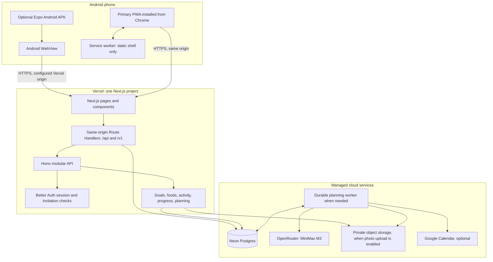
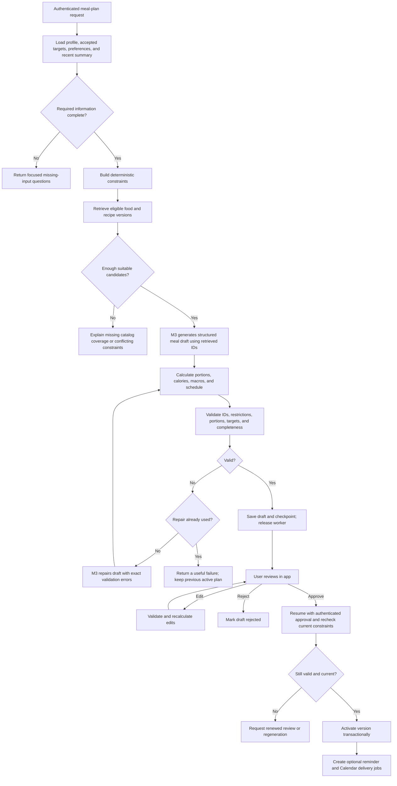
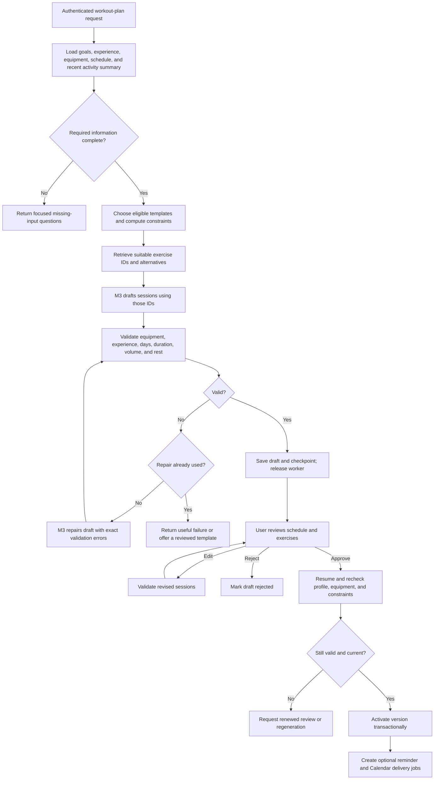
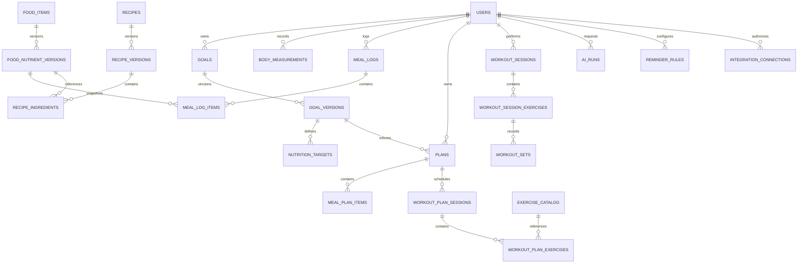
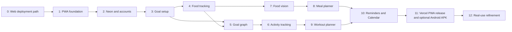

# Goal Health — Product, Architecture, and Implementation Plan

**Working name:** Goal Health; final public-facing name can be chosen before inviting friends.

**Document date:** 20 October 2026.

**Audience:** The owner and developers implementing the app.

**Distribution:** The primary Android experience is the installable HTTPS PWA hosted on Vercel. A thin private APK wrapper remains an optional install path. Any verified Google account can sign up; email/password accounts require invitations.

**Status:** Active implementation plan. The Next.js PWA is the shared product UI and the simplest Android install path. A thin Expo WebView APK can be built with EAS as an optional package. See Decisions 0005 and 0006.

This plan consolidates the agreed features and current PWA-first direction. Decision 0005 describes the optional Android APK wrapper; Decision 0006 establishes the PWA as the default install path. Details that were not explicitly chosen are proposed defaults. Feature support and provider limits must be confirmed before enabling each integration. The APK is a WebView shell around the deployed app; it does not automatically add native Android capabilities.

## Contents

1. [Product goal and decisions](#1-product-goal-and-decisions)
2. [Features and release scope](#2-features-and-release-scope)
3. [Design system and screen structure](#3-design-system-and-screen-structure)
4. [Onboarding, goals, and target calculations](#4-onboarding-goals-and-target-calculations)
5. [Food database and tracking](#5-food-database-and-tracking)
6. [Workout and activity tracking](#6-workout-and-activity-tracking)
7. [Progress graph and forecasting](#7-progress-graph-and-forecasting)
8. [Technology stack and architecture](#8-technology-stack-and-architecture)
9. [AI calls and model configuration](#9-ai-calls-and-model-configuration)
10. [Two LangGraph workflows and memory](#10-two-langgraph-workflows-and-memory)
11. [Database design](#11-database-design)
12. [API and connectivity](#12-api-and-connectivity)
13. [Android PWA capabilities and limits](#13-android-pwa-capabilities-and-limits)
14. [Reminders and Google Calendar](#14-reminders-and-google-calendar)
15. [Privacy, reliability, and cost controls](#15-privacy-reliability-and-cost-controls)
16. [Implementation phases](#16-implementation-phases)
17. [Vercel deployment runbook](#17-vercel-deployment-runbook)
18. [Using the app](#18-using-the-app)
19. [Release acceptance and future work](#19-release-acceptance-and-future-work)
20. [Reference documentation](#20-reference-documentation)

## 1. Product goal and decisions

Build an Android app that helps a person understand how daily food, exercise, and actual body measurements relate to a chosen goal and timeline. The central experience is a progress graph showing the original plan beside measured progress. Food and workout logging provide the inputs for that experience.

The app should work comfortably for Indian meals, household portions, mixed dishes, packaged snacks, restaurant food, and the foods the invited group actually eats. A curated catalog should grow from real usage rather than attempting to import every possible food before launch.

### 1.1 Decisions already agreed

| Area | Decision |
| --- | --- |
| Main platform | Android phones |
| Audience | Users with verified Google accounts, with separate private accounts; email/password signup remains invite-based |
| Distribution | Deploy the PWA to Vercel and install it from Android Chrome; optional private EAS-built APK; no Play Store listing |
| Cloud database | Neon Postgres |
| AI model | MiniMax M3; the selected `minimax/minimax-m3` identifier is an OpenRouter route |
| AI orchestration | Two bounded LangGraph workflows: meal planning and workout planning |
| Food photos | A separate recognition operation that suggests food matches |
| Food quantities | User enters or confirms the amount; the image does not establish an exact portion |
| Nutrition values | Derived from stored food or recipe data and confirmed quantities |
| Core differentiator | Interactive actual-versus-plan progress graph |
| Visual style | Minimal black, white, gray, and lime/green, based on the supplied references |

### 1.2 Current implementation defaults

- Next.js App Router, React, TypeScript, and a responsive PWA provide the product UI.
- Android Chrome installs the Next.js PWA from its stable HTTPS Vercel origin; `apps/mobile` is an optional Expo WebView wrapper that EAS can build as a private APK.
- One Vercel project hosts both Next.js pages and same-origin API routes. Next Route Handlers forward `/api/*` and `/v1/*` to the modular Hono API.
- Neon Postgres is the cloud source of truth. Better Auth allows sign-up with any verified Google account and requires invitations for email/password sign-up.
- Keep OpenRouter credentials and all trusted provider calls in server routes/workers, never in browser code.
- Add private object storage only when photo recognition is implemented; keep photos private and short-lived by default.
- Use browser storage for install metadata and safe UI preferences. Cloud logging requires a network connection; do not promise robust offline writes until an encrypted, account-scoped PWA data/outbox design is implemented.
- Meal/workout plans use two bounded LangGraph workflows, persisted state, deterministic validation, and explicit user review. Food-photo understanding is a separate vision request, not a general autonomous agent.
- Manual step and activity logging is the supported first path. The WebView APK cannot provide direct Health Connect integration or dependable background step collection without a separately implemented native bridge.
- Google Calendar can be optional through a web OAuth flow. Reminder support depends on browser permission and installation state; provide in-app reminders as the reliable baseline.
- Adults using general fitness and nutrition tracking are the initial supported audience.

The small audience does not mean the backend runs on a laptop. Vercel serves the app/API continuously and Neon hosts the data. Each user opens the same HTTPS app URL; Android Chrome can add it to the home screen. The laptop is used to develop and apply reviewed schema migrations.

## 2. Features and release scope

### 2.1 First complete private release

| Feature group | Included behavior |
| --- | --- |
| Accounts | Verified Google sign-up, invite-gated email/password sign-up, login, logout, session renewal, account recovery |
| Profile | Measurements, goal, food preferences, allergies, activity habits, equipment, schedule, units, timezone |
| Food catalog | Search, aliases, common portions, source information, favorites, recent foods, custom foods and recipes |
| Food logging | Manual food/quantity entry, photo-assisted identification, multiple foods per meal, editing and deletion |
| Nutrition | Calories, protein, carbohydrate, fat; fiber and other nutrients when available |
| Meal plans | A structured weekly plan with catalog references, portions, totals, substitutions, review, and approval |
| Workout plans | A weekly schedule based on goals, experience, equipment, available days, and session time |
| Activity logs | Sets, reps, weights, walking/cardio duration, optional steps, completion notes |
| Progress | Actual measurements, trend, original plan, goal/date marker, history, contextual annotations |
| Daily dashboard | Food totals, workout status, steps when available, reminder status, and logging completeness |
| Android integration | PWA installation from Chrome as the default; optional APK wrapper for the hosted app, photo picker, and only capabilities supported by the WebView |
| Reminders | Meal logging, workout, weigh-in, optional hydration, weekly review |
| Calendar | Opt-in synchronization of approved schedule items to an app-created Google calendar |
| Offline | Read cached static shell; core logging requires connection in the first release unless an explicit offline queue is implemented |
| Privacy | Each person sees their own records; export and deletion controls |
| Distribution | Vercel HTTPS URL, open Google sign-up, email/password invite process, add-to-home-screen guide, documented web release process |

Hydration is an optional simple log and reminder, not a requirement for calorie tracking. Heart rate is not a launch requirement because the app cannot assume the phone or a wearable supplies it. Friends do not automatically see one another's health data.

### 2.2 Milestones

1. **Manual tracking MVP:** Accounts, onboarding, food catalog, manual food/workout logging, and the main progress graph.
2. **AI milestone:** Food recognition and both reviewed planning workflows.
3. **Connected private release:** Web reminders, optional Google Calendar, release hardening, and a stable Vercel deployment for friends.

Deploy the manual MVP to a private Vercel project so the graph and logging experience can be used before all integrations are finished.

## 3. Design system and screen structure

### 3.1 Visual direction

Use the supplied images as visual references for spacing, rounded cards, food photography, typography hierarchy, and the green accent. Create original screen layouts for this app's functions. Android status bars, system navigation, and permissions should follow Android behavior.

Proposed design tokens:

| Token | Proposed value | Purpose |
| --- | --- | --- |
| App background | `#F6F7F4` | Soft off-white page background |
| Card surface | `#FFFFFF` | Primary content containers |
| Primary text | `#121512` | Headings, values, main copy |
| Secondary text | `#626A60` | Captions and supporting details |
| Soft divider | `#E7EBE3` | Borders and separators |
| Lime accent | `#B8EA55` | Buttons and selected states, with dark text |
| Light green surface | `#E3F4BE` | Selected cards and gentle highlights |
| Dark green | `#2E6B33` | Actual progress line and readable green labels |
| Warning/error | Accessible amber/red | Exceptions and validation; always include text |
| Typeface | Inter | Proposed sans-serif; the reference font has not been positively identified |

Use tabular numerals for changing measurements, an 8-point spacing rhythm, generous margins, card radii around 20–24 dp, and pill-shaped controls. Primary touch targets should be at least 48 dp. Check final color contrast, font scaling, and TalkBack behavior. Lime is an accent; small lime text on white will usually need a darker alternative.

Food photography belongs on welcome, meal, and recipe views. The progress graph should have a calm background and enough space to read its axes. Avoid decorative chart lines that could be confused with data.

### 3.2 Navigation

Use four labeled bottom tabs: **Home, Food, Activity, Progress**. A visible add button opens quick actions: log food, take/select food photo, log workout, add weight. Profile and settings open from the Home avatar.

| Screen | Main content and actions |
| --- | --- |
| Welcome | Short product explanation, goal graph preview, signup/login |
| Onboarding | A few focused steps with a progress indicator and editable review |
| Home | Greeting, goal summary, compact hero graph, today's food totals, activity, next reminder |
| Food | Day selector, meals, calories/macros, manual search and photo actions |
| Food search | Search, favorites, recents, portion selector, source/preparation labels |
| Photo review | Recognized candidates, uncertain items, manual search fallback, quantity confirmation |
| Meal plan | Week overview, meal details, swaps, nutritional totals, approve/edit controls |
| Activity | Today's workout, walking/cardio entries, steps and source, manual log controls |
| Workout session | Exercises, sets/reps/load, rest timer, completion notes |
| Workout plan | Weekly split, equipment requirements, session duration, review and approval |
| Progress | Large interactive graph, metric selector, time range, annotations, weekly review |
| Settings | Units, profile, goals, connections, reminders, privacy, data export, app version |

Every important view needs empty, loading, offline-fallback, permission-denied, and error states. Display dates as local dates and label the source/freshness of imported values when those are added.

## 4. Onboarding, goals, and target calculations

### 4.1 Inputs

Collect required inputs first and request integration permissions only when the person enables the relevant feature.

| Group | Inputs |
| --- | --- |
| Identity/display | Display name, preferred units, timezone |
| Measurements | Age or date of birth, height, current weight, measurement date |
| Goal | Lose, gain, or maintain weight; optional strength/fitness goal; target weight; preferred timeline or pace |
| Baseline activity | Typical work/activity level, walking habits, current exercise frequency |
| Food | Vegetarian/vegan/other preference, allergies, exclusions, preferred cuisines, disliked foods |
| Practical constraints | Meals per day, cooking access, available preparation time, optional budget |
| Exercise | Experience, gym days, home days, home equipment checkboxes, session duration, walking access, movement limitations |
| Reminders | Preferred meal/workout/weigh-in times and quiet hours |
| Optional connections | Google Calendar; native Health Connect is deferred |

Do not ask users to choose a calorie equation during initial setup. A goal may track the weight timeline without setting a calorie or macro target; manual daily targets remain optional. Keep any formula-based estimate behind a separately reviewed, explicit choice. Do not send a date of birth to the model when an age range is enough.

Ask about factors that make automatic general-purpose planning unsuitable, such as pregnancy or a clinician-directed diet. In such cases allow logging and user/clinician supplied targets; do not generate a standard weight-change prescription. The initial app should not automatically plan weight loss for children.

### 4.2 Goal and nutrition target engine

The backend owns target calculations. Implement a versioned calculation module with documented inputs, coefficients, limits, and rounding. Select and review the actual energy equation and pace limits during implementation rather than allowing the LLM to invent them.

The process is:

1. Validate measurement units, values, and dates.
2. Use an explicit manual target if provided; otherwise accept a weight-only goal when no reviewed formula has been selected.
3. Assess the requested target/timeline against the supported planning policy.
4. When an approved formula or manual target is available, show the calorie target and explain its assumptions; otherwise offer a weight-only timeline.
5. Let the user review and accept the proposal.
6. Store a new goal version and target version with effective dates and calculation metadata.
7. Create the graph's planned trajectory from that accepted version.

**Energy accounting policy for the first release:** Nutrition targets already account for the person's typical activity. Display workout energy as an estimate, and do not automatically add all reported exercise calories back to the food allowance. Future imported energy/step sources and manual workout estimates must never be blindly summed together.

Store calorie and macro targets as compatible ranges with a versioned tolerance policy. Catalog energy can differ from a simple `4 × protein + 4 × carbohydrate + 9 × fat` estimate because of fiber, labeling, and rounding. Flag large discrepancies for review rather than replacing authoritative catalog values automatically.

### 4.3 Changes after onboarding

New weigh-ins update actual progress. They do not silently rewrite the original goal or its historical line. A person can explicitly revise their target, timeline, preferences, or equipment. Save a new version and keep the old plan available in history.

Offer a weekly review when enough new information exists. Suggest changes with an explanation and let the person accept them. One missed meal log or one unusual weigh-in should not automatically change the target.

## 5. Food database and tracking

### 5.1 Catalog strategy

Start with approximately 300–500 carefully reviewed entries and expand according to searches and actual meals. This count is a proposed starting scope, not a completeness guarantee.

Cover ingredients, cooked staples, prepared Indian dishes, common regional meals, packaged snacks, beverages, and frequent restaurant items. Include alternatives such as rice versus cooked rice, plain roti versus oil-added roti, and different recipe versions of dal or biryani.

Each entry needs:

- Canonical name, language/transliteration aliases, category, preparation state, and searchable tags.
- Nutrition per 100 g of edible portion, with missing nutrient fields represented as unknown rather than zero.
- Documented portions such as grams, one roti, one piece, one katori, and one pack.
- A gram conversion for each supported portion and a note where household sizes vary.
- Brand/source identifiers, source date, evidence or label reference, and quality status.
- Allergen and dietary metadata, including unknown or possible contamination where relevant.
- An owner for private custom foods; reviewed shared entries remain a separate catalog permission.

USDA FoodData Central is a useful import source with public-domain/CC0 data. IFCT is a useful Indian food reference, but obtain or confirm reuse rights before importing or redistributing its contents. The NIN website publishes reproduction restrictions, and IFCT values are predominantly for raw foods; neither licensing nor cooked-dish equivalence should be assumed. [USDA API and licensing][usda] [NIN][nin] [IFCT reference][ifct]

Import data through a script or controlled admin action, with provenance and duplicate review. Everyday search reads the app's own catalog. External food APIs are an optional missing-item fallback, not a per-log dependency.

### 5.2 Search

Use Postgres full-text search plus `pg_trgm` where supported, normalized aliases, category filters, and user recency/favorites. Support common spelling variants and transliteration. Use server-side query/indexing for catalog search; keep only harmless recency preferences in the browser. A dedicated vector database is not required for launch.

If nothing matches, offer custom food creation or a recipe builder. An unreviewed custom entry should show its source and quality. An LLM suggestion alone is not enough to publish a verified shared nutrition entry.

### 5.3 Manual logging

```text
Choose date and meal → Search food → Select preparation/version
→ Enter quantity/unit → Convert to grams → Preview nutrition → Save
```

For each nutrient with a known value:

```text
logged nutrient = nutrient per 100 g × consumed grams / 100
```

Support multiple foods in a meal, copying a previous meal, saved combinations, favorites, and editing/deleting. Store the original quantity/unit and the resolved grams. A portion-size change later must not silently change an old meal.

### 5.4 Recipe builder

Store ingredient food versions and gram weights, cooking yield in grams, portions, recipe instructions, and optional adjustments such as oil retained. Sum ingredient nutrition, apply any explicitly supported documented adjustments, then divide by measured cooked yield to obtain per-100-g values. Reject circular recipe references and unsupported quantities. Unknown cooking losses remain uncertainty rather than fabricated precision.

Examples such as home-cooked dal should have the user's recipe version instead of pretending every household prepares identical dal. Private recipes can be proposed for shared review without exposing the creator's meal history.

### 5.5 Photo-assisted logging

1. The person takes a photo or selects one through the Android picker.
2. The app resizes/compresses it, corrects orientation, and removes unnecessary location metadata.
3. Upload through a short-lived authenticated upload authorization to private object storage.
4. A single M3 vision operation returns visible food candidates, alternatives, and uncertainty notes.
5. Match those labels to the stored catalog using normal search.
6. The person confirms or changes each match and enters the quantity.
7. Compute nutrition from confirmed catalog versions and quantities; save normally.

For mixed plates, show multiple selectable items. For hidden ingredients or uncertain dishes, ask for confirmation. Model-reported confidence is an uncalibrated hint, not permission to auto-log. Offer manual logging when photo upload/model recognition fails or no suitable match exists.

Default photo retention: delete temporary recognition photos after a short documented period, proposed as seven days, unless the person explicitly chooses to keep a photo with the log. Delete object files as well as database references. A saved log remains valid after its temporary photo is removed.

## 6. Workout and activity tracking

### 6.1 Exercise library

Create a reviewed exercise library with stable IDs, movement categories, required equipment, supported logging units, technique descriptions, easier alternatives, and estimated duration. Start with a focused set of common exercises and walking/cardio options.

Workout plans should use library IDs and reviewed templates. Equipment includes bodyweight, resistance bands, dumbbells, barbells, machines, and walking space. Do not assume gym access.

### 6.2 User-entered plans and logs

Allow the user to create their own weekly routine, select exercises, define sets/reps/load or time, and choose rest days. Validate custom plans using the same structural rules used for generated plans.

During a session the person can record completed sets, actual reps, weight with unit, optional perceived effort, duration, notes, and skipped/substituted exercises. A workout can differ from its plan without altering the plan's history.

Walking and cardio entries can include duration, distance, and steps when known. Strength progress should use an exercise-specific metric such as completed load/reps over time; it should not be mixed onto the body-weight chart's vertical axis.

### 6.3 Activity energy and duplicates

Track the origin of every imported or estimated value. Prefer an available trusted source for a given time interval; otherwise show a labeled estimate using the chosen reviewed estimation method. Do not claim that sets and repetitions alone establish accurate calorie expenditure.

A manually logged walk may describe the same activity already included in an imported step total or exercise session. Link or reconcile overlapping records, and preserve manual entries without adding their energy a second time. Daily step totals from multiple sources or multiple phones are not additive by default.

## 7. Progress graph and forecasting

### 7.1 Main graph

The full graph is a first-class product feature, available on Home in compact form and on Progress in detail.

| Layer | Visual treatment | Meaning |
| --- | --- | --- |
| Recorded measurements | Small visible dots | Actual recorded values and dates |
| Actual trend | Solid dark-green line | A documented smoothing of measured values |
| Accepted plan | Dashed gray line | The path implied by the accepted goal and timeline |
| Goal | Labeled target/date marker | The accepted end point or maintenance band |
| Optional forecast | Dotted lighter line | An estimate based on sufficiently recent measurements |
| Events | Small selectable annotations | Plan revision, workout milestone, or user note |

X-axis: calendar date. Y-axis: selected metric and its unit. Press/drag should expose the exact date, measurement, trend, planned value, and available context. Offer 7-day, 30-day, 90-day, and full-goal views. Provide an accessible text summary and a list/table of points.

Do not use a decorative histogram as the primary progress view. Secondary nutrition and steps views may use simpler charts when appropriate, but weight, calories, steps, and strength must retain their own units and axes.

### 7.2 Deterministic graph calculations

**Planned trajectory:** The first release uses linear interpolation as a visual plan, not a biological prediction:

```text
fraction = clamp((date - start_date) / (target_date - start_date), 0, 1)
planned_weight = start_weight + fraction × (target_weight - start_weight)
```

Handle a missing deadline, an invalid date interval, and maintenance goals separately. A maintenance goal uses a user-approved range rather than a descending or ascending line.

**Actual values:** Preserve raw measurements. When several readings exist on one local day, use a documented daily representative value, proposed as the median, while keeping individual readings inspectable. The initial trend can be a trailing seven-calendar-day mean of available daily values, with at least three distinct measured days. Show gaps and sample counts; never treat missing measurements as zero.

**Goal progress:** For gain or loss goals with distinct start and target weights:

```text
progress_fraction = (current_trend - start_weight) / (target_weight - start_weight)
```

Clamp a progress indicator for display if needed, retain the underlying value, and show overshooting or movement away from the goal honestly. For maintenance, report time and measurements in the target band instead of using that fraction.

**Plan comparison:** Show the difference between actual trend and the planned value for that date. Label the direction appropriately for gain/loss. Avoid converting this difference into a guaranteed number of days ahead or behind.

### 7.3 Forecasting rules

Forecasting is optional for the first release and must never delay actual-versus-plan tracking.

- Use recent actual measurements, not a cumulative food-calorie equation as a substitute for measured weight.
- Proposed eligibility: at least six distinct measurement days spanning at least fourteen days within the recent 28-day window. Tune after real usage.
- Fit a documented trend method; store its version and date range.
- Limit the extrapolation horizon and show the available evidence.
- If the slope is flat, moving away from the target, or too unstable, show that an arrival estimate is unavailable.
- Do not display a statistical confidence band unless the method and its interpretation have been implemented and reviewed.

Weight change depends on more than a fixed calories-to-kilograms conversion. The NIH Body Weight Planner and its underlying research are references for later model development, not a license to claim that our first-release line is a validated physiological model. [NIH Body Weight Planner][body-weight-planner]

### 7.4 Daily context and weekly review

Below the chart, show calorie/protein target adherence, workouts completed, steps when available, and food-log completeness. Make missing-data states visible: an empty food day can mean not logged, not zero intake.

Allow the person to mark a food day complete. Report observed adherence only over sufficiently complete days. A graph point can show same-day logged food/activity context without claiming that one meal caused a same-day weight change.

The weekly review should prioritize measured change, coverage of logs and weigh-ins, consistency, and the next action. A short M3 explanation is optional; every numerical statement must come from a computed summary payload.

## 8. Technology stack and architecture

### 8.1 Proposed stack

| Layer | Choice | Reason |
| --- | --- | --- |
| Product UI | Next.js App Router, React, TypeScript | One responsive web app powers both the browser PWA and Android APK shell |
| Android package | Expo SDK 57, React Native, `react-native-webview` | Single-entry Android shell that opens the hosted product UI and is distributed as a private APK |
| Hosting | Vercel | Hosts the Next.js UI and server routes at one HTTPS origin; no laptop or separately hosted API is needed |
| UI and graph | CSS design tokens, Manrope, accessible SVG line chart | Matches the black/white/green references and makes actual-versus-plan progress clear |
| Browser data | Same-origin requests; React state for temporary view state | Avoids a second API URL or secrets in the browser bundle |
| API | Next Route Handlers forwarding into the Hono modular API | Reuses server-side contracts and domain modules within the same deployment |
| Database | Neon Postgres + Drizzle ORM/migrations | Cloud source of truth, relational constraints, and versioned schema |
| Authentication | Better Auth on the server with open verified Google sign-up and invite-gated email/password accounts | Keeps session validation and database credentials server-side |
| Contracts/domain | Shared Zod contracts and pure deterministic TypeScript services | Validate input/output independently of the model |
| AI orchestration | Two bounded LangGraph workflows for meal and workout plans | Persisted state, explicit branches, bounded repair, and user approval |
| Model access | Server adapter to OpenRouter → MiniMax M3 | Multimodal model stays replaceable and its key never reaches the browser |
| Food photos | Browser file picker plus private object storage when implemented | User confirms food and portion; the vision result only suggests candidates |
| Calendar | Optional Google Calendar API through web OAuth | Cross-device schedule sync with explicit consent |
| PWA cache | Service worker caches only the static shell and safe public assets | Avoids caching private health responses or authentication data |

The current project already uses a modular Hono API and mounts it behind Next Route Handlers. Keep one deployable application for now. Do not split every domain into a service.

Android Chrome installs the PWA directly from Vercel as the default phone experience. The optional Expo APK shell loads the same Next.js pages in a WebView; it does not duplicate domain logic or UI. A WebView does not provide the same Android privileges as a native feature implementation: direct Health Connect access, reliable background step collection, and native scheduled notifications require explicit bridges and device verification. Treat offline mutation/sync as a later explicit feature, not an automatic consequence of installing an APK.

### 8.2 Architecture diagram



The laptop runs the local development server and reviewed migration command. After deployment, Vercel serves the UI/API and Neon stores data independently. A user's phone does not connect to the laptop.

### 8.3 Design patterns and module boundaries

Use a **modular monolith**: one deployable TypeScript application with modules for identity, catalog, food logs, goals, progress, activity, planning, integrations, and reminders. HTTP handlers authenticate and validate; domain services calculate; repositories issue owner-scoped SQL; provider adapters contain external APIs.

Use deterministic calculations for calories, macros, target paths, and graph series. LLMs return structured suggestions only. Validate every response against schemas and catalog/exercise IDs, show a draft, and require user approval before it changes an active plan.

Use explicit state machines for plans and AI runs. Persist input snapshots, model/version metadata, checkpoints, status, and idempotency keys. Do not expose LangGraph state as a general-purpose user memory store; durable user preferences belong in normal profile tables.

```text
apps/
  web/                    Next.js PWA, pages, manifest, service worker
  backend/                Hono API, auth, domain routes, provider adapters
  mobile/                 Expo Android WebView shell and EAS APK configuration
packages/
  contracts/              Zod schemas and API types
  domain/                 Pure calculations and validation policies
  database/               Drizzle schema, migrations, repositories
  planning/               LangGraph definitions and state schemas
scripts/
  catalog/                Source import, normalization, curation tools
docs/
  operations/             Deployment, recovery, owner runbook
```

Keep the Expo shell free of server credentials. Its `EXPO_PUBLIC_APP_URL` is public build configuration and must point to the stable deployed app origin. The web app can be redeployed without rebuilding the APK; native shell or package changes require a new APK.

### 8.4 Background execution

Do not start a long workflow with an unawaited promise inside an API request. For an initial small release, keep each online request bounded and persist the run state. Before enabling multi-step plans, verify Vercel function duration against actual provider latency. If generation can outlive the function request, write a durable Postgres job and run it from a separate worker/dispatcher; the job row and LangGraph checkpoint are the source of truth.

Return a run ID only after the job is durably stored. The UI polls status while visible; approval resumes/revalidates the saved draft. Retries must be idempotent. The worker is a later deployment addition only if real workflow duration requires it; simple web hosting does not require it.

## 9. AI calls and model configuration

### 9.1 Calls by feature

| Operation | M3 call? | Trigger and boundary |
| --- | --- | --- |
| Manual food search/log | No | Catalog lookup and numeric calculation |
| Food photo recognition | Yes | Explicit photo submission; output candidates only |
| Nutrition target proposal | No | Reviewed deterministic calculation policy |
| Weekly meal plan | Yes | User requests a new plan or an explicit revision |
| Meal substitution | Sometimes | Prefer a valid catalog substitution; model only for a requested more involved revision |
| Weekly workout plan | Yes | User requests a new plan or explicit revision |
| Workout logging | No | Normal structured input |
| Calorie/macro update | No | Recompute from logged portions and stored nutrient values |
| Steps/activity sync | No | Native data import and reconciliation |
| Graph refresh | No | Query and deterministic trend calculations |
| Reminder scheduling | No | Accepted schedule and user settings |
| Calendar synchronization | No | Deterministic mapping of approved schedule items |
| Weekly narrative | Optional | One compact explanation of already computed facts |

### 9.2 M3 configuration

Use a server-only model adapter. The OpenRouter model ID is `minimax/minimax-m3`; direct MiniMax access uses its own endpoint and model identifier. Keep route, reasoning settings, timeouts, budgets, and output schema version in server configuration.

M3 supports image input and toggling thinking. Proposed starting policy: thinking off for straightforward photo labeling when the route supports it, on for meal/workout planning. Actual supported request fields must be verified against the selected endpoint. Equal token rates for thinking modes do not mean equal request cost: extra generated reasoning tokens can increase the total. [MiniMax M3][minimax-m3]

Use JSON Schema output when supported. On OpenRouter, structured output support can vary by serving provider; set routing to require the needed parameters and validate the selected route's image and schema support. If required capabilities are unavailable, return a controlled error instead of silently accepting weaker output guarantees. LangGraph can retrieve database candidates itself, so these workflows do not require autonomous model-selected database tool calls. [OpenRouter structured outputs][openrouter-structured] [Provider routing][openrouter-routing]

Initial configurable output ceilings, to tune from actual usage:

- Photo recognition: approximately 1,200 output tokens.
- Weekly meal plan: approximately 6,000 output tokens, using IDs and compact structured fields.
- Workout plan: approximately 4,000 output tokens.
- Optional weekly narrative: approximately 500 output tokens.

Do not stream reasoning text into the app. Show task status such as “Finding suitable meals” and display a validated draft when ready.

### 9.3 Cost example

The current direct MiniMax standard rate for M3 with up to 512K input tokens is $0.30 per million input tokens and $1.20 per million output tokens. OpenRouter rates depend on the selected serving route and must be checked separately. [MiniMax API pricing][minimax-pricing] [OpenRouter M3][openrouter-m3]

For an illustrative direct-API text request with 8,000 input and 3,000 billable output tokens:

```text
input:  8,000 / 1,000,000 × $0.30 = $0.0024
output: 3,000 / 1,000,000 × $1.20 = $0.0036
total:                                  $0.0060
100 such requests:                      $0.60
```

This excludes additional image/reasoning token consumption, retries, route differences, and infrastructure costs. Track actual usage rather than using this example as a monthly quote. Database, storage, authentication/email, scheduling, Vercel hosting, and optional push infrastructure are separate cost categories.

## 10. Two LangGraph workflows and memory

Use two workflows with shared retrieval, validation, persistence, and model-adapter utilities. Each has a fixed purpose and a maximum of one semantic repair attempt after the initial draft. No separate planner, critic, and reviewer models are needed for the initial app.

### 10.1 Meal-planning workflow



Meal plan output contains dates/meal slots, food or recipe nutrition-version IDs, quantities in supported units, resolved grams, and short rationale/substitution notes. The backend derives all authoritative nutrition totals. If a necessary food or suitable allergen-safe candidate is unknown, the workflow asks for a change or more data rather than inventing an entry.

### 10.2 Workout-planning workflow



Workout validation must include unsupported exercises, location-specific equipment mismatches, gym/home day limits, impossible scheduling, session duration, missing rest, and the bounds defined for the supported experience level. Movement limitations require suitable reviewed alternatives; the LLM should not diagnose injuries or choose rehabilitation protocols.

### 10.3 State and durable memory

| State/memory | Stored where | Contents and rules |
| --- | --- | --- |
| Long-term user facts | Normal Neon profile/preference tables | Explicit preferences, accepted goals, equipment; editable by the user |
| Historical evidence | Normal log tables | Measurements, food/activity records, approved plan history |
| Compact planning context | Run input snapshot | Relevant recent summaries, retrieved IDs, goal/preference versions |
| Workflow state | LangGraph Postgres checkpoints | Current node, draft, errors, repair count, review pause |
| Product status | `ai_runs` and `plans` | UI-visible status, ownership, completion/error, activated version |
| Optional conversational context | Short-lived scoped records | Only what the current edit/request needs |

Example state contract:

```typescript
type PlanningState = {
  runId: string;
  userId: string; // resolved from the authenticated server session
  workflow: 'meal_plan' | 'workout_plan';
  goalVersionId: string;
  preferenceVersion: number;
  inputSnapshotHash: string;
  constraints: Record<string, unknown>;
  candidateVersionIds: string[];
  draft: unknown;
  validationErrors: Array<{ code: string; path: string; message: string }>;
  repairCount: number;
  planId?: string;
  reviewDecision?: 'approve' | 'reject' | 'edit';
};
```

Use a new server-generated run/thread ID for each generation. Bind it to the authenticated owner. Do not use an arbitrary client-supplied thread ID as proof of access. Isolate checkpoint tables in a dedicated database schema, and use the official compatible Postgres checkpointer.

LangGraph checkpoints and interrupts allow a workflow to pause for user review and resume later. Resume handlers must reauthorize the owner, revalidate edits, and reject stale assumptions. Side effects and saved drafts must be idempotent because a node can execute again during recovery. [LangGraph workflow concepts][langgraph-thinking] [Persistence][langgraph-persistence]

### 10.4 Execution limits and failure policy

- At most two semantic model attempts per plan generation: draft plus one repair.
- Network retries use separate bounded limits and backoff; they must not create duplicate plans.
- Use provider timeout, token, per-user, and daily spend limits.
- Persist usage/cost metadata, schema version, model route, and validation outcome.
- Never activate a partial/truncated, invalid, or unapproved output.
- A failed replacement leaves the previous approved plan usable.
- Profile/goal changes during generation mark the draft stale or require revalidation before approval.
- A requested entirely new draft is a new explicit operation with a new run ID and budget.

## 11. Database design

### 11.1 Conventions

Use UUID primary keys for application records, `timestamptz` for instants, local `date` for day-based records, and explicit IANA timezone IDs. Store canonical units as kilograms, centimeters, grams, kilocalories, seconds, meters, and nutrient grams/milligrams as specified per column. Preserve the user's entered unit separately.

Use appropriate `numeric` precision for nutrition and quantities; round for display instead of repeatedly rounding source values. Keep unknown nutrition as `NULL`. Include `created_at`, `updated_at`, `version`, and deletion/tombstone metadata where records synchronize to devices.

The auth provider owns its own account/session tables. Application `users` map an opaque auth subject to an internal UUID; application code does not assume provider IDs are UUIDs or create its own password table.

### 11.2 Identity, preferences, and goals

| Table | Important fields | Rules |
| --- | --- | --- |
| `users` | `id`, `auth_subject`, `display_name`, `status`, `timezone`, `unit_preferences` | Unique auth subject; account lifecycle |
| `invitations` | `code_hash`, `expires_at`, `max_uses`, `use_count`, `created_by` | Signup access enforced server-side; no plaintext invitation secret in logs |
| `profiles` | `user_id`, height, birth year/date or age basis, equation parameter, activity level, limitations | Minimize sensitive fields; explicit calculation inputs |
| `preferences` | `user_id`, `revision`, diet, allergens, exclusions, meal slots, prep time, budget | Version every change that affects planning |
| `user_equipment` | `user_id`, equipment ID, optional weight ranges | Supported enum/catalog IDs |
| `user_availability` | `user_id`, weekday, local start window, duration | Explicit timezone and recurrence meaning |
| `goals` | `id`, `user_id`, type, `status`, `current_version_id` | One selected primary goal at a time |
| `goal_versions` | `goal_id`, start measurement, target weight/range, start/target dates, accepted time | Immutable accepted versions |
| `nutrition_targets` | `user_id`, `goal_version_id`, effective range, calories/macros, method, rule version | Preserve historical target changes |
| `body_measurements` | `user_id`, timestamp, local day, weight, optional waist, source, external ID | Preserve raw measurements and import provenance |
| `trajectory_points` | `goal_version_id`, local date, planned value, trajectory method | Rebuildable from the accepted goal version |

### 11.3 Food catalog and food logs

| Table | Important fields | Rules |
| --- | --- | --- |
| `catalog_sources` | provider, source reference, license, revision date, attribution | Required provenance for imported records |
| `food_items` | `id`, canonical name, category, preparation, brand, owner, visibility, review status | Shared reviewed catalog or private custom entry |
| `food_aliases` | `food_id`, normalized alias, locale | Searchable names/transliterations |
| `food_nutrient_versions` | `food_id`, per-100-g nutrients, source ID, quality, effective date | Immutable versions; all prepared recipes also resolve to a nutrient version |
| `food_servings` | `food_id`, label/unit, grams, evidence/version | Version or snapshot conversions used in logs |
| `food_tags` | `food_id`, tag, certainty/source | Diet and allergen filtering; distinguish unknown from absent |
| `recipes` | `id`, resulting `food_id`, owner, name, visibility | Recipe identity |
| `recipe_versions` | `recipe_id`, yield grams, portions, instructions, resulting nutrient-version ID | Immutable composition and yield |
| `recipe_ingredients` | recipe-version ID, ingredient nutrient-version ID, grams | Derive totals and propagate relevant restrictions |
| `favorite_foods` | `user_id`, `food_id` | Unique user/food pair |
| `meal_logs` | `id`, `user_id`, timestamp, local day, meal slot, notes | Meal container; idempotency key makes retried online creates safe |
| `meal_log_items` | meal ID, nutrient-version ID, quantity/unit, resolved grams, nutrition snapshot, origin, optional media reference | Historical values do not change with catalog edits |
| `food_day_status` | `user_id`, local day, timezone, completeness status | Distinguish incomplete tracking from zero intake |
| `hydration_logs` | `user_id`, timestamp, local day, volume in mL, original quantity/unit | Optional simple water log; no inferred fluid consumption |
| `media_assets` | owner, private object key, type, size, status, expiry, keep-with-log choice | Never store public bucket URLs or image bytes in log rows |

Record a snapshot of the name, serving conversion, and calculated nutrient values on each logged item, alongside the immutable nutrient-version reference. This keeps history understandable if catalog names are changed or items retired. Use source energy when available; mark any derived or estimated energy explicitly.

### 11.4 Plans, exercise, and activity

| Table | Important fields | Rules |
| --- | --- | --- |
| `exercise_catalog` | name, category, equipment, units, technique, alternatives, review/source | Stable IDs and supported metadata |
| `workout_templates` | experience, goal category, weekly frequency, template version | Reviewed starting structures |
| `plans` | owner, kind, plan group, version, edit version, source, status, JSONB snapshot, approval time | Current workout versions use a validated structured snapshot; drafts are editable, active versions are immutable, and each group has one active and one draft version at most |
| `meal_plan_days` | plan ID, local date/day index | Structured weekly schedule |
| `meal_plan_items` | day ID, meal slot, nutrient-version ID, grams, portion label, derived totals | Same food references as manual logs |
| `workout_plan_sessions` | plan ID, weekday/date, start time, duration, session purpose | Weekly split and scheduling |
| `workout_plan_exercises` | session ID, exercise ID, order, sets/reps/load/time/rest targets | Unit-aware fields |
| `workout_sessions` | owner, planned-session reference, start/end, status, notes | Actual performed session |
| `workout_session_exercises` | workout-session ID, exercise ID, order, notes | Actual exercise grouping |
| `workout_sets` | session-exercise ID, set number, reps, load/unit, duration, effort | Actual completed values |
| `activity_entries` | owner, start/end, activity type, duration, distance, optional steps, energy estimate, source | Manual/cardio activity with overlap metadata |
| `health_import_records` | owner, device, record type, origin, external ID, revision, deletion state | Reserved for a future native Health Connect companion; not used in the PWA MVP |
| `health_daily_aggregates` | owner, local day, timezone, window boundaries, device/source selection, metrics, sync time | Future native companion: replace/upsert the same source/window, never add snapshots |
| `activity_links` | manual record, imported record, relation/reconciliation choice | Future imported-source reconciliation to prevent duplicate energy |
| `daily_summaries` | owner/day/timezone, food totals, completeness, selected steps/activity, target version, computation version | Derived cache; rebuildable |

The PWA workout-plan editor stores sessions and exercise targets in the versioned `plans.data` snapshot. This keeps each proposed or approved revision together while the first release is online-first. Accepting a meal plan does not automatically mark its food as consumed. Starting a planned workout only prefills a blank activity form; actual performance is saved separately after the user enters what they completed.

### 11.5 Integrations and operational tables

| Table | Important fields | Rules |
| --- | --- | --- |
| `devices` | owner, installation ID, platform, app version, last seen | Optional browser installation identity; future native extension |
| `reminder_rules` | owner, type, local time, weekdays, timezone mode, enabled, quiet hours | Preferences are authoritative in Neon; delivery support is browser-dependent |
| `device_reminder_instances` | installation ID, rule ID, occurrence, notification ID | Optional delivery bookkeeping; idempotent cancel/reschedule |
| `integration_connections` | owner, provider, scopes, encrypted credentials, key version, expiry/status | Google credentials stay server-side; native Health Connect has no cloud OAuth token |
| `calendar_event_links` | owner, calendar ID, logical occurrence key, remote event ID, plan revision, status | Create/update/delete only mapped app-owned items |
| `ai_runs` | owner, type, status, input snapshot/hash, route, schema version, usage, error, result reference | Product-facing audit and status |
| LangGraph checkpoint tables | Official checkpointer-managed schema | Durable workflow state; separate from normal user profile memory |
| `jobs` | type, owner, payload reference, status, attempts, lease, next run, error | Durable work and recovery |
| `idempotency_keys` | owner, endpoint, key, request hash, status, saved response, expiry | Same key/different payload is rejected |
| `user_changes` | owner, ordered revision, entity type/ID, operation, version | Reserved for a future offline/native sync feed; not part of online-first PWA MVP |
| `audit_events` | owner/actor, action, entity, timestamp, redacted metadata | Log critical changes without recording secrets or full health payloads |
| `push_subscriptions` | device, provider token, enabled, invalidated time | Optional later remote completion notifications |

Health import, browser/device-sync, and change-feed tables are future-extension points carried over from the earlier native design; the online-first PWA MVP does not use them. It does not mirror private logs into browser storage. The service worker caches only public static assets; authenticated health data remains server-side.

### 11.6 Main entity relationships



This is a conceptual relationship diagram; the table descriptions define intermediate day/session tables omitted for readability.

### 11.7 Constraints, access, and indexes

- Every private row has an owner, or ownership follows a checked parent relation. Validate nested IDs against that same owner.
- Shared catalog records are readable; only the review/admin path can publish changes.
- Private recipe ingredients cannot reference another person's private food entries.
- Enforce positive quantities, sensible measurement bounds, valid time ranges, supported units, and uniqueness of imported source IDs.
- Use partial unique indexes so only one active plan of each kind exists per user and only one primary active goal is selected.
- Activate a plan and supersede its predecessor in one transaction. Check the expected plan/profile revision.
- Index owner plus log day/time, parent IDs, normalized catalog search, external import identity, job readiness/lease, and user-change revision.
- Use database constraints and owner-scoped repositories; add row-level security where the selected connection/auth pattern reliably supplies transaction-local user context. Do not claim RLS protection from a privileged service role that bypasses it.
- Apply ordered migrations. Keep synthetic development data separate from production health data.

## 12. API and connectivity

### 12.1 Same-origin API surface

The browser calls the Vercel deployment at the same origin. Resolve identity from the validated Better Auth session, validate all inputs with shared schemas, and scope each private query to the authenticated user.

| Route | Purpose |
| --- | --- |
| GET /v1/me | Profile, preferences, connection flags |
| PUT /v1/me | Update profile and preferences |
| POST /v1/goals/proposal | Deterministic goal and target proposal |
| POST /v1/goals/accept | Accept a versioned goal |
| GET /v1/foods?query=... | Search accessible catalog entries |
| POST /v1/foods/custom | Create a private food with per-100-g nutrition values and source note |
| POST /v1/food-logs | Save an idempotent food entry with a nutrition snapshot |
| POST /v1/food-logs/copy | Copy a selected meal to another local date with server-checked ownership and retry-safe IDs |
| PATCH/DELETE /v1/food-logs/:id | Version-checked changes and soft deletion |
| POST /v1/activity-logs | Save manually entered steps or activity duration |
| GET /v1/workout-plans | List the signed-in user's draft and approved workout plan versions |
| POST /v1/workout-plans | Create a draft from a reviewed template or manual input |
| PATCH /v1/workout-plans/:id | Save a draft with an edit-version check |
| POST /v1/workout-plans/:id/revise | Copy the active plan into a new draft version |
| POST /v1/workout-plans/:id/approve | Revalidate and activate the draft; supersede the prior active version |
| GET /v1/days/:date | Timezone-aware food/activity records and calorie/macro/step totals |
| GET /v1/exercises/:exerciseId/progress?range=30d\|90d\|365d | Daily reps, load, and timed-hold performance from that account's logged sets |
| PUT /v1/days/:date/food-status | Mark the food log complete or incomplete for a local date |
| POST /v1/foods/custom | Create a private food with user-supplied nutrition values |
| POST /v1/foods/recipes | Create a private recipe and calculate nutrition from saved ingredient snapshots and finished yield |
| PUT /v1/foods/recipes/:id | Optimistically edit a recipe, recalculate nutrition, and append an immutable version |
| GET /v1/foods/recipes/:id/versions | List owner-scoped recipe snapshots and their creation dates |
| POST /v1/food-logs | Idempotent food-entry creation |
| POST /v1/food-logs/copy | Copy a prior meal to a selected day while preserving local time and nutrition snapshots |
| PATCH/DELETE /v1/food-logs/:id | Version-checked changes and soft deletion |
| POST /v1/measurements | Add a measurement with source metadata |
| POST /v1/hydration-logs | Optional water entry with explicit volume/unit |
| POST /v1/workout-sessions | Actual workout, exercises, and sets |
| POST /v1/activity-entries | Manual walking/cardio/step entry |
| GET /v1/days/:date | Daily summary with timezone/completeness |
| GET /v1/progress | Measured, trend, planned, and eligible forecast series |
| POST /v1/uploads | Scoped temporary authorization for a food image |
| POST /v1/food-recognition/runs | Start a photo-recognition operation |
| POST /v1/plans/meal/runs | Start meal planning |
| POST /v1/plans/workout/runs | Start workout planning |
| GET /v1/ai-runs/:id | Read authorized run status/result |
| PATCH /v1/plans/:id | Validate and save draft edits |
| POST /v1/plans/:id/approve | Revalidate, activate, and enqueue side effects |
| POST /v1/plans/:id/reject | Reject a draft |
| PUT /v1/reminders | Update reminder preferences |
| POST /v1/connections/google/start | Begin authorized Calendar connection |
| POST /v1/connections/google/disconnect | Revoke/erase connection credentials |
| POST /v1/export | Start a data export |
| DELETE /v1/account | Confirmed account/data deletion process |

Use consistent error codes such as INPUT_REQUIRED, CONFLICT, PLAN_STALE, CATALOG_GAP, PERMISSION_REQUIRED, MODEL_UNAVAILABLE, and BUDGET_EXCEEDED. Return a request ID and actionable message without exposing internal errors.

### 12.2 Online-first writes

For the first release, save user logs through authenticated HTTPS requests. Show a pending state while saving and confirm success only after the server commits. Use idempotency keys for create requests and expected versions for edits so browser retries or double taps cannot create duplicate meals/workouts or overwrite a newer edit.

The PWA caches only public static assets. Do not persist private health records, session responses, or API data in a service-worker cache. If the connection is unavailable, explain that a log was not saved and provide a retry action.

### 12.3 Concurrent edits and local-day handling

Use record versions and server transactions to detect a stale edit from another browser/device. Preserve the saved record and ask the user to reload/reapply their edit rather than silently overwriting newer values.

Store actual timestamps and the logging timezone. Proposed default: preserve the original logging day and timezone, and display a clear converted time when the user travels. Compute day summaries with the recorded timezone so the same meal does not shift days without explanation.

### 12.4 Connectivity boundaries

- Viewing and writing private data, catalog search, photo recognition, AI planning, and Calendar sync require the deployed HTTPS API and an internet connection.
- The service worker offers an offline shell and help text only; it does not imply that unsent logs are stored.
- Static resources may remain cached. Do not cache authenticated API responses, session endpoints, or private images.
- If Vercel, Neon, or a model provider is unavailable, show a retryable status and keep already saved cloud data intact.
- Do not assume a phone will run background work on a schedule.

## 13. Android PWA, optional APK, and native limits

### 13.1 Supported web-app path

The default Android install path is the PWA: open the production HTTPS URL in Chrome and choose Add to Home screen / Install app. Vercel serves the web UI and API; Neon stores account data. This path needs no EAS setup or APK. An optional signed APK built with EAS launches an Expo WebView at the same origin. Neither path needs a Play Store listing. The APK needs a one-time Expo account/EAS project setup and a new APK when its native shell configuration changes.

Use the hosted app's file picker for meal photos. Keep account sessions in secure, same-origin cookies within the WebView. Respect safe areas, touch sizes, keyboard behavior, font scaling, Android back navigation, and external-link boundaries. Verify file selection and cookie persistence on real Android devices.

The service worker should cache the static shell and safe assets only. Do not cache authenticated API responses, meal logs, profile/goal data, session endpoints, or private images by default. Show an offline page when unavailable. Cloud writes need an active connection until a separate local data/outbox feature is designed and validated.

### 13.2 Steps, Health Connect, and native capabilities

A WebView around a PWA cannot directly call the Android Health Connect SDK or reliably collect all-day steps in the background. The first release therefore supports manual step and activity entry. Do not display an unavailable Health Connect connection as if it were implemented.

If reliable phone sensor collection becomes important, implement a focused native module and a safe bridge to the web UI. Health Connect integration needs availability checks, purpose explanations, minimal requested permissions, source-aware aggregate reads, revocation handling, deduplication, and real-device verification. Do not claim step sync until those behaviors work on target phones.

### 13.3 Future native transition

Keep contracts and domain calculations independent of the web UI. A future Health Connect or notification module can be added to the existing Expo shell without moving database access or model credentials to the device.

## 14. Reminders and Google Calendar

### 14.1 PWA reminders

Start with in-app reminders and user-selected time preferences. Browser notifications are optional and depend on browser support, install state, permissions, and user settings; they are not guaranteed background alarms. Never make food logging or workout completion depend on a notification arriving.

Keep reminder content private on lock screens. Add controls to pause, reschedule, and disable reminders. For dependable scheduled notifications on every supported phone, a later native client may be needed.

### 14.2 Optional Google Calendar connection

Calendar is a separate opt-in connection from app login. Start with one-way synchronization from approved app schedules into a dedicated app-created calendar. Avoid reading or editing unrelated personal events.

Use a supported Google web OAuth flow with exact redirect URLs registered in Google Cloud. Bind authorization state to the signed-in user, validate callbacks, request only the needed Calendar scope, and keep any confidential client secret and refresh-token encryption key on the server. Check Google consent-screen testing and refresh-token rules before inviting friends.

Flow:

```text
User enables Calendar and selects what to sync
→ Web OAuth authorization with state validation
→ Server exchanges and encrypts the authorized token
→ Create/select this connection's app-created calendar
→ Map approved workout occurrences to events
→ Persist event links and delivery status
```

### 14.3 Event delivery and duplicate prevention

- Default to syncing workouts; let the user opt into meal slots to avoid calendar clutter.
- Use a stable logical occurrence key, plan revision, calendar ID, and remote event ID.
- Make event insertion retry-safe and reconcile against stored app metadata before re-creating an event.
- Plan edits update/cancel only app-owned mapped events. Use a bounded future horizon and replenish it.
- A failed Calendar update appears as pending/failed and retries without blocking food or workout logging.
- Let users choose app reminders, Calendar notifications, or both, with a duplicate-reminder explanation.
- Disconnect stops future delivery, revokes/deletes credentials, and offers an explicit choice about existing app-created events.
- Initial synchronization is one-way. Explain conflicts if users edit/delete a mapped Calendar event.

Calendar creation and reminders are deterministic side effects of an approved plan or explicit user setting. The model cannot publish events while merely generating a draft.

## 15. Privacy, reliability, and cost controls

### 15.1 Account and data boundaries

Allow any Google account with a verified email to create an account; require an email-bound invitation for email/password sign-up. A private URL is not authentication. Validate sessions, resource ownership, nested references, file access, AI run ownership, and integration ownership on every relevant request.

Use HTTPS, private file access, managed password handling, secure same-origin session cookies, and encrypted Google refresh credentials with a server-held encryption key. Keep database passwords, OpenRouter keys, storage signing credentials, and OAuth secrets in server environment variables. Never expose them as NEXT_PUBLIC values.

The Settings screen exports profile, current records and change history, personal foods, plans, AI planning inputs/history, reminder preferences, and safe Calendar metadata to a JSON file. It excludes authentication credentials and OAuth tokens. Account deletion requires the current password and typing `DELETE`; user-owned live rows cascade, LangGraph checkpoints are deleted, Google token revocation is attempted, and local reminder markers are cleared. The app-created Calendar and its events can remain in Google after account deletion. Neon provider backups retain deleted data until the configured backup retention window expires; review the selected Neon plan's retention before inviting friends. Temporary photo objects are not yet used by the deployed feature path; add object deletion before enabling external photo storage.

### 15.2 Provider exposure and prompt handling

Send only task-relevant context to M3: necessary preferences, target ranges, eligible catalog/exercise IDs, and compact summaries. Avoid names, email, exact birth date, full histories, and unrelated notes.

Review OpenRouter and serving-provider retention/training settings and select the intended routing policy. A provider-routing preference is not by itself a promise of zero retention. Persist route/setting metadata and explain the actual photo-processing path to the user.

Treat notes, food descriptions, imported text, and model outputs as untrusted data. Never let model text execute SQL, choose arbitrary internal URLs, override ownership, or directly write to Calendar. Allergies and restrictions are explicit user facts checked by code; uncertain catalog metadata must not be advertised as verified suitability. Current planners send compact JSON as user-role data, explicitly treat every input string as untrusted, and expose no tools. Meal candidates are server-selected; personal food source notes are omitted; the server accepts only candidate IDs and calculates nutrition itself. Workout IDs must be in the server-filtered exercise set. Both outputs pass strict schemas and deterministic checks, allow at most one repair, and pause for user review before activation.

### 15.3 Operations and recovery

- Maintain separate development and production databases/branches, credentials, and storage namespaces.
- Use versioned migrations, a pre-migration backup strategy, and a documented restore exercise.
- Define environment-specific job dispatch and retry/dead-letter handling.
- Lease jobs and recover expired leases; distinguish provider timeouts from invalid outputs.
- Record redacted request IDs, execution durations, job backlog, concurrent-edit conflicts, provider errors, and per-run token/cost usage.
- Avoid storing raw images, secrets, meal histories, or reasoning traces in generic logs/analytics.
- Monitor database/storage usage, error rates, job age, and AI spend.
- Keep essential tracking available during model or Calendar outages.

### 15.4 Cost policy

Apply configurable per-user request limits, a global daily/monthly budget, upload-size limits, image compression, and bounded model output. The app currently applies a configurable limit of 10 AI operations per account per rolling 24-hour window across photo recognition and meal/workout planning; each plan operation can make at most two model requests because it allows one repair. Cache repeated eligible catalog retrieval and allow reuse of a still-valid draft rather than silently regenerating it.

Cache planning results only within the proper owner and input version: goal, preferences, catalog/exercise versions, schedule, and request variant. A preference change must invalidate an unsuitable plan cache.

Per-call token counts and OpenRouter-reported USD costs are persisted on AI runs, including repair calls; unavailable cost remains null. The app has per-account rolling operation limits. Configure the shared OpenRouter API-key spending cap for the global hard ceiling and verify it before inviting friends. The app does not reserve or reject requests against a second internal dollar budget. Recheck all infrastructure plan limits before inviting more people.

## 16. Implementation phases

The sequence delivers tracking and the signature progress graph before AI features. The product UI remains a web PWA, installed directly from Chrome by default; private Android APK packaging is optional under Decisions 0005 and 0006. Native Health Connect and Play Store work remain outside the current scope. Work estimates should be set after the first end-to-end deployment.

### Phase 0 — Confirm the web deployment path

- Confirm the Vercel project domain, Neon region/database, open Google sign-up, and invited email/password access.
- For this npm workspace monorepo, set the Vercel Framework Preset to Next.js and Root Directory to `apps/web`; enable **Include source files outside of the Root Directory in the Build Step** so the app can use the backend and shared packages at the repository root.
- Confirm the root environment names and ensure the ignored local environment file stays out of Git.
- Verify that the PWA manifest, service worker, same-origin API routes, and auth origins match the selected domain.
- Record the PWA limitation: manual steps/activity first; no direct Health Connect integration.
- Keep AI provider calls disabled until the server-side secret is configured.

**Current status:** On 21 October 2026, repository typecheck, lint, and production Next.js build passed. The local root `.env` has the app's database, auth, and OpenRouter values and is ignored by Git; its auth base URL is still local. The GitHub repository is connected to `main`, and the Vercel import flow has `apps/web` and Next.js selected. The assigned production domain and Production variables still need to be confirmed in the owner's Vercel account.

**Deliverables:** PWA/Vercel decision record, deployment checklist, safe environment template.

### Phase 1 — PWA foundation and visual system

- Build the Next.js responsive app shell with the supplied minimal black, white, gray, and lime-green theme and Manrope.
- Implement dashboard, Food, Activity, and Progress navigation for mobile and desktop widths.
- Implement the install manifest, original app icon, static-only offline fallback, and same-origin API bridge.
- Ensure no server secret enters client JavaScript or service-worker caches.

**Deliverables:** Installable web shell with responsive sample screens.

**Exit criteria:** It builds as a Next.js project and opens in Android Chrome; screen reader labels, keyboard, safe areas, and touch sizes are usable.

### Phase 2 — Neon, authentication, invitations, and schema

- Provision Neon Postgres and apply reviewed Drizzle/auth migrations from a trusted local checkout.
- Verify Better Auth email/password invitation enforcement and open Google sign-up/sign-in, cookie session, sign-out, and account isolation.
- Check access isolation with separate accounts and ensure every private query is owner-scoped.
- Deploy the same Next.js/Hono application to Vercel; do not create a separate API deployment.
- Create an email/password invitation through the owner CLI.

**Current status:** Better Auth, application-schema, and LangGraph migrations have been applied to the configured Neon database. Google OAuth is configured and its callback reaches the deployed app; the current source allows any verified Google email to create a private account. Email/password sign-up remains invitation-based. The Vercel redeployment of open Google sign-up, signup-flow checks, and two-account isolation remain to be completed.

**Deliverables:** Hosted login, open Google sign-up, and invitation-backed email/password accounts.

### Phase 3 — Onboarding and accepted goal engine

- Implement the onboarding steps and editable review.
- Store profile, restrictions, equipment, availability, units, and timezone.
- Implement deterministic target calculation, manual target mode, feasibility feedback, and versioned acceptance.
- Create planned trajectory points and weight-measurement entry.
- Preserve old goal versions when a goal changes.

**Deliverables:** Signup-to-goal flow and deterministic calculation module.

### Phase 4 — Food catalog and manual food tracking

**Current status:** Search and manual logging work for shared catalog rows and per-account custom foods. The search includes account-scoped favorites and recently logged foods across both catalog sources, matches curated alternate names, and supports per-account household portion shortcuts for shared or personal foods. The FNDDS importer can add source-provided shared serving weights; these are survey references, while household sizes and recipes vary. Portion IDs and grams are validated against a shared catalog record or saved user-owned portion, and the confirmed label and nutrition snapshot stay with the food log. On 21 October 2026, the configured Neon catalog was seeded with 5,431 generic foods and 22,118 FNDDS portion references from the public-domain USDA JSON archive. Of those records, 33 have been source-checked and marked reviewed for general (unrestricted) AI meal plans; 5,398 remain unreviewed and available only for manual search/logging. The reviewed foods have 92 USDA portion references; all 5,431 foods have 22,118 portion references. Neon currently has no dietary/allergen safety-review rows, so constrained meal plans fail closed until accurate metadata is curated. The import is idempotent by source and FDC ID. The import maps common names and South Indian spellings for available dishes such as idli, dosa, sambar, upma, vadai, and chutney. FNDDS is a US survey source and covers only a small subset of Indian dishes; missing regional dishes such as rasam and puli kuzhambu still need individually sourced entries or private recipes. Users can build and edit private recipes from catalog or personal foods, add cooking instructions, preview per-100-g macros, and save server-calculated nutrition. Recipe edits create owner-scoped immutable revision snapshots, while existing food logs retain their original nutrition snapshots. Users can also preview and copy a meal from a prior local date; the server checks ownership/date/meal, preserves nutrition snapshots and local time, and makes retries idempotent. The catalog publish command now shows source provenance and per-100-g values, then requires interactive confirmation; it can review up to 50 selected active FNDDS rows atomically for general AI meal plans, while diet/allergen-constrained plans still require separate safety metadata. Reviewed regional-food coverage remains outstanding.

- Create import/curation tools and grow the reviewed catalog of common group foods from the generic FNDDS starter and individually verified entries.
- Add aliases, preparation states, portions, provenance, and catalog quality labels.
- Implement food search, recents/favorites, custom foods, and recipe creation.
- Implement meal logs, quantities, copied meals, edits/deletes, and nutrition snapshots.
- Add daily totals, macro display, and a control distinguishing incomplete food logging from a complete zero-intake day.

**Deliverables:** Usable daily manual nutrition tracker.

### Phase 5 — Signature progress graph and daily dashboard

**Current status:** The dashboard and Progress page render the accepted target trajectory beside timezone-aware weigh-ins, with a rolling average over up to three recorded weigh-in days, 30/90-day and full-goal ranges, a target-date marker, accepted goal-version annotations, and a written comparison summary. An authenticated seven-day review now summarizes complete food days, calories and protein on complete days, walks/workouts, logged steps, daily median weigh-ins, and the latest measured-versus-planned comparison. Incomplete food days and absent records remain unknown, and averages exclude incomplete food days. The API reports trend-estimate eligibility only after at least six distinct measurement days spanning fourteen days within the latest 28 days; it does not generate an arrival date. Typecheck and lint pass; live API and Android browser verification remain outstanding.

- Add accessible textual summaries and a weekly review payload. Gate forecasts until sufficient measurements exist. **Implemented in code; live verification remains.**

**Deliverables:** Home and Progress views backed by real data.

**Exit criteria:** Actual measurements are visually distinct from the planned path; missing data is never drawn as zero.

### Phase 6 — Exercise, user plans, and manual activity

**Current status:** Manual steps/walks/cardio and structured strength sessions are implemented. Strength logs support version-checked edits, soft deletion, date-selectable cross-day history, rep-based sets with optional load, and timed holds. The `starter-v2` catalog contains 47 curated exercises with stable IDs, movement patterns, equipment, primary muscles, technique cues, easier alternatives where available, tracking mode, and typical rest guidance. Three starter templates can prefill actual session logs or create persistent editable weekly plan drafts. Plans support weekday schedules, exercise and set targets, optimistic edits, explicit activation, immutable approved versions, revision history, and starting a session with blank actual-performance fields. Progress also has an exercise-specific graph for daily best reps, best load, or longest timed hold, separate from the body-weight graph. Activity history labels each saved record as a manual entry, and no workout calorie burn is estimated. Source fields for imported Health Connect data remain deferred until a native integration exists; broader exercise catalog coverage remains outstanding.

- Continue reviewing and expanding the exercise catalog and starter workout templates.
- Expand plans with AI-generated, reviewed drafts and explicit plan-to-completion links after the workout-planning workflow is implemented.
- Continue reviewing and improving exercise-specific progress metrics.
- Label the current manual activity source and preserve clear provenance for later imported sources. **Manual activity is labelled; imported-source provenance remains deferred until an integration exists. Workout calorie-burn estimates remain disabled.**
- Keep exercise progress separate from the body-weight graph; do not invent calorie-burn values.

**Deliverables:** Complete manual tracking MVP.

### Phase 7 — Food photo recognition

**Current status:** The authenticated API sends a browser-compressed image to the configured OpenRouter model and validates a bounded list of food-name candidates. The PWA lets the person search those names in the catalog, choose a food, enter the amount, and save through the existing nutrition calculation. Photo files are not stored by the app. Each request is counted in the shared per-account rolling 24-hour AI quota; token counts and provider-reported USD cost are recorded without retaining the image. Live provider checks and Android Chrome verification remain outstanding.

- Keep browser image processing bounded to a 2.5 MB JPEG, PNG, or WebP payload.
- Send the image through the authenticated server API; keep the OpenRouter key server-only and do not persist the photo.
- Return food names and alternatives only; never infer portion size or nutrition from the image.
- Match candidate labels to the app catalog and let the person confirm food and quantity.
- Keep the manual catalog-search path available when recognition is disabled or fails.

**Deliverables:** Photo-assisted logging using the same catalog-based nutrition calculation path.

**Exit criteria:** A photo never establishes exact portions or calories; uncertain/mixed dishes can be corrected.

### Phase 8 — Meal-planning LangGraph workflow

**Current status:** The authenticated backend creates idempotent AI runs, retrieves reviewed shared foods and account-owned foods, calls M3 through OpenRouter with structured output, calculates meal and day nutrition from catalog snapshots, validates seven consecutive dates and daily calorie bounds, performs at most one repair, saves an editable draft, and pauses a Postgres-checkpointed LangGraph run for explicit review. The PWA lets the user change a draft item to another catalog food, edit its grams, see provisional recomputed nutrition, and save through server-side catalog ownership and nutrition-range validation. Draft updates use optimistic edit versions; approval rechecks the accepted goal/profile snapshot. If approval finds stale inputs or a concurrent edit, the review screen refreshes the saved plan list and explains what changed. If saving detects a concurrent edit, local unsaved changes remain visible and an explicit discard-and-reload action is provided. Catalog foods now have separately reviewed dietary and allergen metadata, managed with `npm run catalog:safety:review`; search, edits, and approval filter or revalidate supported constraints. Unknown restrictions fail closed, and personal foods are excluded from a constrained plan until their safety metadata can be reviewed. These tags do not guarantee allergy safety or prevent cross-contamination. The live catalog currently has zero dietary/allergen safety-review rows, so constrained profiles fail closed; accurate metadata must be curated on enough foods before those plans can run. OpenRouter shared-key spend-limit setup/verification, timeout behavior against the live Vercel plan, and live Neon/OpenRouter planner validation remain outstanding. The shared per-account rolling 24-hour quota is enforced for this and the other AI operations.

- Improve stale-input recovery in the review screen. **Implemented in code; deployed workflow checks remain outstanding.**
- Curate enough reviewed catalog entries with `npm run catalog:safety:review` to cover common dietary preferences and restrictions; tags must be based on current labels or reliable recipes.
- Set and verify the OpenRouter shared-key spending cap and verify provider latency/repair behavior on the deployed function limits; per-account quotas and per-call tokens/costs are recorded across AI features.
- Do not log planned food as eaten unless the user confirms it.

**Deliverables:** Reviewed weekly meal plans.

### Phase 9 — Workout-planning LangGraph workflow

**Current status:** The profile collects experience, available training days, preferred session length, equipment, and movement limitations. The authenticated API filters the reviewed exercise catalog by equipment, includes only aggregated recent activity, calls M3 with structured output, and validates exercise IDs, tracking mode, frequency, rest, set/repetition ranges, weekly volume, and server-estimated duration. It allows one repair, stores an idempotent run and Postgres checkpoint, and creates a reviewable draft. The PWA supports edits, explicit rejection or activation, history, stale-input checks, and transactional superseding. Starting an active planned workout creates a blank actual-log form; the saved activity links back to the plan version and session only after the user records it. Minors, pregnancy/breastfeeding, and stated movement limitations are blocked from AI suggestions; template and manual logging paths remain available. Live Neon/OpenRouter, real Vercel duration/cost limits, OpenRouter shared-key spend-limit setup/verification, and real-device review remain outstanding. The shared per-account rolling 24-hour operation quota is enforced.

- Set and verify the OpenRouter shared-key spending cap shared with meal planning; per-account rolling 24-hour operation limits and per-call cost tracking already apply across both planners and photo recognition.
- Verify prompt/schema compatibility and actual function duration against the deployed model route.
- Expand reviewed exercise/equipment metadata and improve recovery when profile inputs have changed.

**Deliverables:** Reviewed workout plans. No generated draft is an actual workout until the user records completion.

### Phase 10 — Reminders and optional Google Calendar

**Current status: implemented; live connection verification remains.** Per-user reminder preferences persist in Neon and use the profile's timezone. Opt-in browser notifications are checked while the app is open and use generic lock-screen text; they are not alarms while the PWA is closed. The Settings screen supports Google OAuth connect/disconnect and user-triggered one-way sync of approved workouts to a separate Goal Health calendar. Refresh tokens are AES-256-GCM encrypted at rest, OAuth state is single-use and user-bound, event IDs are deterministic, and sync reconciles the next 28 days. No Google credentials, live connection, or Vercel deployment have been configured.

- Add in-app reminder preferences and optional browser notifications with clear permission/failure states.
- Use web OAuth only after the owner configures it; encrypt refresh tokens server-side with the `TOKEN_ENCRYPTION_KEY`.
- Let the user sync approved workout occurrences idempotently to an app-created Calendar.
- Keep activity logging usable if reminders or Google are unavailable.

**Deliverables:** Reminder preferences, foreground PWA notifications, optional Calendar OAuth, disconnect, and 28-day one-way workout sync. Verify the flow using a configured Google test account and deployed redirect URL before enabling it for friends. Sync is started explicitly from Settings; drafts never create Calendar events.

### Phase 11 — Production hardening and private release

**Current status: in progress.** The app now has an owner-scoped JSON export, password-confirmed account deletion, LangGraph checkpoint cleanup, and migrations that force row-level security on personal tables. Authenticated API responses use `Cache-Control: private, no-store`. On 21 October 2026, Better Auth, Drizzle application, and LangGraph migrations were applied to the configured Neon database. A read-only inventory confirmed all 18 public tables containing `user_id` or `owner_id` have RLS enabled and forced, each with one policy; migration `0019_force_recipe_version_rls` closed the recipe-history table gap. Runtime two-account isolation checks, a backup/restore exercise, live OAuth/provider verification, OpenRouter shared-key spend-limit setup/verification, Vercel deployment, EAS project linking, and Android APK installation checks remain outstanding. The EAS CLI currently has no signed-in Expo account, and the deployed HTTPS origin is not yet available for `EXPO_PUBLIC_APP_URL`. A configurable per-account rolling 24-hour quota plus per-call token and provider-reported cost accounting now cover food vision and both planners.

- Configure production Vercel environment variables, define a Neon backup policy, and rehearse a restore. Apply future schema changes from the trusted checkout with reviewed migrations.
- Verify login, invitations, two-user isolation, browser and APK behavior, error handling, deletion/export, and restore procedures.
- Check accessibility, privacy/cache behavior, upload retention, provider limits, and actual AI cost before enabling each model workflow.
- Share the HTTPS link with intended users; any verified Google account can sign up.

**Deliverables:** Stable Vercel PWA, owner runbook, friend onboarding instructions, and an optional privately distributable Android APK.

**Exit criteria:** A friend can install the PWA from Chrome (or the optional APK), sign in, log data, and view their own progress while the developer's laptop is off.

### Phase 12 — Real-use refinement

- Gather explicit feedback on logging friction, missing foods, graph clarity, plans, and reminders.
- Review actual model spend, latency, validation failures, and operational errors.
- Expand the catalog from confirmed requests and quality sources.
- Version changes to graph rules, goals, prompts, and templates.

**Exit criteria:** The group can use the app routinely and understand measured data versus estimates.

### 16.1 Implementation dependency map



## 17. Cloud deployment and Android installation runbook

Vercel is the web host and server runtime. Neon is the database host. The default Android install uses Chrome to install the PWA; EAS is needed only for the optional APK shell. The source repository connects to Vercel for web deployments; Vercel and Neon are cloud services, not laptop-hosted servers.

### 17.1 One-time setup

1. Create/select the Neon project and database. Copy the pooled PostgreSQL connection string into the ignored local root environment file as DATABASE_URL.
2. Set your chosen AUTH_SECRET in that file and use the same value in Vercel's server environment.
3. Choose the Vercel project name/domain first. Set AUTH_BASE_URL and AUTH_TRUSTED_ORIGINS to that exact HTTPS origin for production.
4. Import the GitHub repository in Vercel and select apps/web as the project root. Keep the detected Next.js framework and npm workspace settings.
5. Add DATABASE_URL, AUTH_SECRET, AUTH_BASE_URL, and AUTH_TRUSTED_ORIGINS as server-side Production Environment Variables in Vercel. Keep DATABASE_URL and AUTH_SECRET private.
6. From a trusted checkout configured for the same database, run reviewed migrations once: npm run db:migrate.
7. Deploy the project and open its HTTPS URL. Test sign-in and invite creation before sharing the URL.

Set AUTH_BASE_URL and the trusted origin to the exact production domain, such as https://your-project.vercel.app. If a custom domain is added, update both values and redeploy. Preview deployment URLs require separately scoped auth settings if authentication is tested there.

The web app uses relative API routes at the same origin. The optional Android shell uses only `EXPO_PUBLIC_APP_URL` to load the hosted app in a WebView. The shell has no separate API client or native feature screens. The URL is public configuration and must not contain credentials.

### 17.2 Environment variables

| Vercel server-only variable | Required when |
| --- | --- |
| DATABASE_URL | Database-backed app/auth is deployed |
| AUTH_SECRET | Better Auth is enabled |
| AUTH_BASE_URL | Better Auth is enabled; set to the public app origin |
| AUTH_TRUSTED_ORIGINS | Set to the exact deployed app origin |
| OPENROUTER_API_KEY | Only when server-side photo recognition/planning is enabled |
| GOOGLE_CLIENT_ID and GOOGLE_CLIENT_SECRET | Optional; enable open sign-up for verified Google accounts and register `/api/auth/callback/google` in Google Cloud |
| GOOGLE_REDIRECT_URI and TOKEN_ENCRYPTION_KEY | Optional; required only for Google Calendar sync |
| Storage and worker variables | Only after private object storage or a separate job worker is deployed |

Do not add database URLs, auth keys, OpenRouter credentials, private storage keys, or token-encryption keys as NEXT_PUBLIC or EXPO_PUBLIC values. Vercel environment variables are set in project settings, not committed into the repository.

### 17.3 Build and verify

From the repository root, the normal web commands are:

```bash
npm install
npm run typecheck
npm run lint
npm run build
```

Run them before inviting users. Keep migrations explicit and reviewed rather than running them in each build. A successful web build does not prove live Neon credentials, account isolation, OAuth, or model behavior; verify those against the deployed project.

Only if you want the optional APK, configure the Expo app after Vercel is live:

1. Install/sign in to EAS and link `apps/mobile` to an Expo project once: `npx eas-cli@latest login`, then `npx eas-cli@latest init` from `apps/mobile`.
2. In that EAS project's `production` environment, set the public `EXPO_PUBLIC_APP_URL` to the production origin.
3. Build the installable APK from `apps/mobile`: `npm run build:apk`.
4. Download the APK from the completed internal build and install it on Android. No Play Store submission is part of this flow.

The repo ignores APK files and EAS signing material. Share the APK/build link privately and keep EAS-managed signing credentials in the Expo account.

### 17.4 Share and update

1. Share the HTTPS URL with the people who will use the app; any verified Google account can sign up. On Android, they open it in Chrome and choose Add to Home screen or Install app.
2. If you created the optional APK, share it from the private EAS build. Friends may need to allow installs from the app they used to download it.
3. Friends can sign up with any verified Google account. Email/password sign-up requires an email-bound invitation.
4. Push reviewed source changes to the connected deployment branch; Vercel builds and deploys the updated web app. Existing APK shells load it on the next launch.
5. Build a new APK only for native shell/configuration changes, then share the new build privately. Keep Neon data and backups independent of either deployment.

The Vercel app and Neon database must remain deployed for APK and browser users to access accounts and cloud data. APK delivery is private; no Play Store listing is created.

### 17.5 Owner responsibilities and future AI jobs

Keep Vercel/Neon accounts accessible, monitor usage/errors, maintain backups, and remove access for friends who should no longer use the service. AI requests must be bounded and recorded with owner, model route, status, and usage.

The first manual-tracking release needs only the deployed Next.js project and Neon. Add the OpenRouter server key when AI features are implemented. If multi-step LangGraph jobs outlast Vercel's request limits, add a durable worker/dispatcher then; it is not required to serve the PWA or deploy the manual MVP.

## 18. Using the app

### 18.1 First use

Open the deployed HTTPS app URL in Android Chrome and choose Add to Home screen, or install the optional APK shared by the owner. Sign up with Google, or use an email-bound invitation for email/password. Then choose units, enter the profile and goal, and review the calculated targets. The Progress view shows the accepted plan; measured history starts with the first confirmed weigh-in.

The PWA and optional APK use the same deployed app and account.

### 18.2 A normal day

1. Open Home to see the goal graph, today's totals, planned workout, and activity status.
2. Search and log a meal manually or select a photo when photo recognition is enabled. Confirm each food and quantity.
3. Log activity, workouts, steps, and optional weight measurements.
4. Mark the food day complete when appropriate so the app can distinguish a complete day from missing logging.
5. View measured progress and context on Progress. The graph refresh is computed from stored data and does not need an AI call.

The first release requires an internet connection for cloud reads and writes. If offline, show a clear unavailable state and never tell the user a log was saved until it is safely stored. AI and Calendar requests also require internet.

### 18.3 Weekly review and revisions

Review measured trend, data coverage, target adherence on complete days, and completed workouts. Adjust food choices or schedule if desired. Request a revised plan when constraints change. A new target/timeline requires explicit acceptance and creates a new goal version; previous measurements and plans remain available.

### 18.4 Common recovery paths

| Situation | User experience |
| --- | --- |
| Photo identified the wrong food | Select another candidate or search manually |
| No nutrition entry exists | Create a private sourced entry/recipe or request catalog review |
| Meal/workout generation fails | Existing active plan remains available; show an actionable reason |
| Phone has no Health Connect path | Enter steps/workouts manually; the PWA does not claim native sync |
| Google authorization expires | Reconnect without losing plans or logs |
| Browser notifications are denied | Keep reminders visible in-app and allow permission settings to be changed |
| Vercel is temporarily unavailable | Show a connection error; do not report unsaved changes as successful |
| Friend changes phones | Open the same app URL and sign back in to retrieve cloud records |
| App update | Reload the deployed URL; cloud data is stored in Neon and is not removed by a web deployment |

## 19. Release acceptance and future work

### 19.1 Acceptance checks to implement during development

This is the planned validation strategy; it is not evidence that these checks have already been run.

| Area | Meaningful acceptance evidence |
| --- | --- |
| Nutrition | Known food/portion and recipe/yield fixtures, unit conversion, unknown nutrients, historical snapshots |
| Goals/graphs | Gain/loss/maintenance, invalid timeline rejection, sparse data, multiple daily measurements, revision history, forecast eligibility |
| Access | Two-user isolation for reads/writes/files/AI runs/Calendar links; private/shared catalog boundaries |
| Web/PWA and optional APK | Production HTTPS origin, manifest, browser add-to-home-screen flow, offline fallback, no private API response in service-worker cache; if built, APK opens the exact production origin |
| AI | Representative Indian meals/mixed plates, ambiguous photos, malformed output, invented IDs, restriction conflicts, one-repair ceiling |
| Workflow recovery | Process restart, expired lease, checkpoint replay, long review pause, stale-input approval, idempotent activation |
| Activity | Repeated records, overlapping manual activities, source changes, multi-device edits, manual step entry |
| Reminders | Browser permission denial, in-app fallback, quiet hours, timezone behavior, no cross-account reminders |
| Calendar | Repeat delivery, plan edits, token expiry, disconnected state, external event changes |
| Release | Vercel build/deployment, Neon connectivity, open Google signup, email/password invitation onboarding, no bundled server secrets, account isolation |
| Recovery/privacy | Export, account deletion including assets/checkpoints, photo cleanup, backup restore, redacted operational logs |

Automate pure domain calculations, authorization integration cases, and retry/recovery invariants. Use focused UI checks plus real Android WebView/APK acceptance for login, food photo picker, navigation/back behavior, and cookie persistence. Health Connect permission checks are required only if a native bridge is later implemented.

### 19.2 Definition of the first complete private release

- A user can open the HTTPS link, create a private account with Google, and optionally add the PWA to their Android home screen.
- Onboarding creates an accepted versioned goal and usable planned trajectory.
- Manual food logging produces catalog-derived calories and macros; photo suggestions are optional and user-confirmed.
- Actual measurements and the goal path are distinguishable and readable on a phone.
- Workouts can be entered or generated, reviewed, approved, and logged.
- Daily tracking works without unnecessary LLM calls.
- Private records are isolated by account and survive browser reloads/redeploys through Neon.
- Manual activity/steps work without claiming direct Health Connect access.
- Reminders and Calendar follow explicit choices and fail without breaking core tracking.
- Secrets stay server-side; export/deletion and recovery behavior are documented.
- The app works from the deployed domain with the developer's laptop off. A user can install and use the Android APK or open the browser URL and create a private Google account.

### 19.3 Future backlog

Consider these after the private APK/PWA release: barcode scanning, optional voice meal entry, larger regional catalogs, grocery lists from approved plans, meal preparation batches, a native Health Connect bridge, better forecasting, optional AI weekly narratives, and richer offline support.

Defer real-time coaching chat, unrestricted autonomous agents, multiple specialist models, a dedicated vector database, public social feeds, subscriptions, iOS-specific native work, and Play Store publication until a real need justifies them.

### 19.4 Decisions to finalize before implementation locks them in

| Decision | Proposed default | Required by |
| --- | --- | --- |
| Public-facing app name | Goal Health working name | Before sharing friend-facing link |
| Automatic target policy | Reviewed adult general-fitness equations and bounds; manual override path | Goal implementation |
| Initial foods/recipes | Group's common foods, reviewed and versioned | Food catalog |
| Provider serving route | OpenRouter M3 route with required capabilities/privacy settings | Before AI release |
| Background planning execution | Bounded Vercel request if proven safe; durable worker only if real run times require it | Before meal/workout workflow release |
| Photo retention | Seven-day temporary retention, optional explicit saved photo | Before photo recognition release |
| Goal trend/forecast rules | Documented initial rules above, versioned and gated | Before progress forecasting |
| Calendar consent rollout | Correct web OAuth production setup or keep Calendar disabled | Before Calendar release |
| Offline logging | Online-first; add only with account-scoped local persistence and conflict policy | Before promising offline support |
| Native Health Connect bridge | Deferred; reconsider only if manual activity is insufficient | Future Android integration decision |

## 20. Reference documentation

Provider features, pricing, quotas, and platform support can change. Recheck vendor documentation before enabling production integrations. The architecture and phase boundaries in this document are application decisions, not provider guarantees.

- [Next.js PWA guide][next-pwa]
- [Vercel Next.js deployment][vercel-next]
- [Vercel monorepo root directory][vercel-monorepo]
- [Better Auth installation and base URL][better-auth]
- [Neon Postgres documentation][neon-postgres]
- [OpenRouter MiniMax M3 route][openrouter-m3]
- [OpenRouter structured outputs][openrouter-structured]
- [OpenRouter provider routing][openrouter-routing]
- [LangGraph workflow concepts][langgraph-thinking]
- [LangGraph persistence][langgraph-persistence]
- [USDA FoodData Central API/licensing][usda]
- [ICMR–NIN website and reuse notice][nin]
- [IFCT 2017 reference][ifct]
- [NIH Body Weight Planner][body-weight-planner]
- [Google Calendar API authorization scopes][calendar-scopes]
- [Google OAuth token lifecycle][google-oauth]
- [Google OAuth application states][google-oauth-state]

[next-pwa]: https://nextjs.org/docs/app/guides/progressive-web-apps
[vercel-next]: https://vercel.com/docs/frameworks/full-stack/nextjs
[vercel-monorepo]: https://vercel.com/docs/monorepos
[better-auth]: https://better-auth.com/docs/installation
[neon-postgres]: https://neon.com/docs/introduction
[openrouter-m3]: https://openrouter.ai/minimax/minimax-m3
[openrouter-structured]: https://openrouter.ai/docs/guides/features/structured-outputs
[openrouter-routing]: https://openrouter.ai/docs/guides/routing/provider-selection
[langgraph-thinking]: https://docs.langchain.com/oss/javascript/langgraph/thinking-in-langgraph
[langgraph-persistence]: https://docs.langchain.com/oss/javascript/langgraph/persistence
[usda]: https://fdc.nal.usda.gov/api-guide/
[nin]: https://www.nin.res.in/
[ifct]: https://www.nin.res.in/ebooks/IFCT2017.pdf
[body-weight-planner]: https://www.niddk.nih.gov/bwp
[calendar-scopes]: https://developers.google.com/workspace/calendar/api/auth
[google-oauth]: https://developers.google.com/identity/protocols/oauth2
[google-oauth-state]: https://developers.google.com/identity/protocols/oauth2/production-readiness/overview
